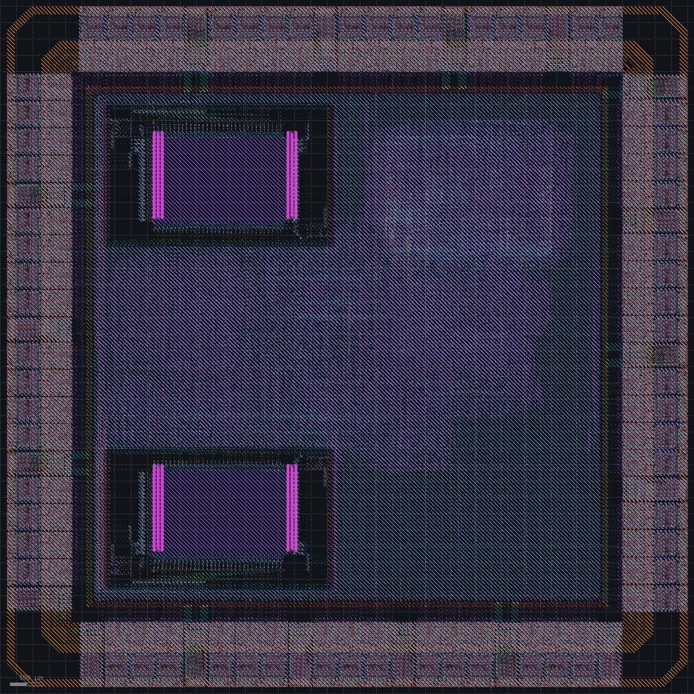

# Complete RTL-to-GDSII implementation and timing closure of a small SoC

A RISC-V SoC taken from RTL to GDSII on SKY130 with open-source tools. Each result of the flow is committed with its reports, and the journal records what it showed and what changed next.

## The SoC

```
                fetch below 0x8000_0000     +----------------+
   +----------+---------------------------->| 2 KB SRAM      |---+ port 0
   | RV32IM   |                             +----------------+   |
   | core     |---------------------------->| 2 KB I-cache   |---+ refill
   +----------+ fetch from 0x8000_0000      +----------------+   |
        | AXI4-Lite                                              |
        v                                                        v
  +-----------------------------------------------------------------+
  |                    AXI4-Lite interconnect                       |
  +-----------------------------------------------------------------+
     ^ boot loader           |                    |
     |                       v                    v
  SPI flash         AXI4-Lite to APB     async FIFOs (clk/mclk)
                             |                    |
       +------+------+-----+-------+------+  SDRAM controller
       | UART | GPIO | SPI | timer | INTC |   (100 MHz)
       +------+------+-----+-------+------+       |
                                           32 MB SDR SDRAM
```

Details are in [docs/spec_v8.md](docs/spec_v8.md). The SoC sits in a pad ring of SKY130 I/O cells.

## The chip



| | |
|---|---|
| Die | 2.12 x 2.12 mm, SkyWater seal ring, 64 signal pads and 18 supply pads |
| Clocks | `clk` and `mclk` at 100 MHz typical; 50 and 62.5 MHz at the slow corner |
| Timing | tt +0.77 / +0.65 ns setup, +0.167 ns hold; ss +1.91 / +1.86 ns setup; ff +0.007 ns hold |
| Power | 50.4 mW without the pad cells, 17.1 mV IR drop from the supply pads |
| Physical checks | Magic and KLayout DRC clean outside the SkyWater I/O cells, LVS clean, antennas 0, density clean with metal fill |
| Simulation | The test passes on the RTL, on the synthesized netlist, and on the routed netlist with the signoff delays |

## Results

All numbers come from `reports/metrics.csv`, which `make metrics` updates. Timing is at the typical corner (tt, 25 C, 1.8 V) with OpenRCX parasitics unless a column says otherwise. `clk` is 20 ns up to row 19, 15 ns from row 20 and 10 ns from row 30; `mclk` is 10 ns from row 11; `pclk` is 16 ns in rows 26 to 37. From row 39, timing runs from the chip pins through the pad cells, power leaves out the pad cells, and `klayout_drc` leaves out errors inside the SkyWater I/O cells, which are counted under `klayout_drc_waived`. From row 40, `magic_drc` leaves out errors on the pad cells' LEF abstracts. From row 41, `wns_ss_ns` and the `_ss` maxima come from the slow corner (ss, 100 C, 1.60 V, maximum RC) and `whs_ff_ns` from the fast corner (ff, -40 C, 1.95 V, minimum RC). From row 42, `fmax_ss_mhz` and `fmax_mclk_ss_mhz` are measured against the slow-corner clocks of 50 and 62.5 MHz, and `density` is the PDK pattern density check on the filled GDS.

<!-- metrics -->
| run | place_density | wns_ns | tns_ns | whs_ns | viol_endpoints | hold_viol | fmax_mhz | wns_mclk_ns | fmax_mclk_mhz | wns_pclk_ns | fmax_pclk_mhz | wns_ss_ns | fmax_ss_mhz | fmax_mclk_ss_mhz | whs_ff_ns | hold_viol_ff | slew_viol | slew_waived | cap_viol | antenna_nets | power_mw | ir_drop_mv | grt_congestion | route_drc | magic_drc | klayout_drc | klayout_drc_waived | density | lvs |
|---|---|---|---|---|---|---|---|---|---|---|---|---|---|---|---|---|---|---|---|---|---|---|---|---|---|---|---|---|---|
| 01-baseline | 0.6000 | -10.063 | -9075.234 | 0.076 | 1210 | - | 33.3 | - | - | - | - | - | - | - | - | - | 3384 | 22 | 156 | 65 | 8.98 | - | 0 | 0 | 1943 | 0 | - | - | mismatch |
| 02-sram-corner | - | - | - | - | - | - | - | - | - | - | - | - | - | - | - | - | - | - | - | - | - | - | 4290 | - | - | - | - | - | - |
| 03-sram-channels | 0.6000 | -8.855 | -8749.597 | 0.084 | 1218 | - | 34.7 | - | - | - | - | - | - | - | - | - | 3941 | 22 | 190 | 48 | 9.10 | - | 0 | 0 | 0 | 0 | - | - | mismatch |
| 04-cts-setup-repair | - | - | - | - | - | - | - | - | - | - | - | - | - | - | - | - | - | - | - | - | - | - | 0 | - | - | - | - | - | - |
| 05-placement-padding | 0.6000 | -3.677 | -3405.824 | 0.077 | 1209 | - | 42.2 | - | - | - | - | - | - | - | - | - | 1834 | 22 | 145 | 102 | 9.53 | - | 0 | 0 | 0 | 0 | - | - | clean |
| 06-instruction-register | 0.6000 | -4.744 | -4707.600 | 0.083 | 1275 | - | 40.4 | - | - | - | - | - | - | - | - | - | 2388 | 22 | 147 | 78 | 9.72 | - | 0 | 0 | 0 | 0 | - | - | clean |
| 07-load-use-stall | 0.6000 | -0.226 | -2.867 | 0.083 | 19 | - | 49.4 | - | - | - | - | - | - | - | - | - | 2763 | 22 | 203 | 62 | 9.92 | - | 0 | 0 | 0 | 0 | - | - | clean |
| 08-wire-rc-calibration | 0.6000 | 2.777 | 0.000 | 0.084 | 0 | - | 58.1 | - | - | - | - | - | - | - | - | - | 207 | 22 | 37 | 84 | 9.90 | - | 0 | 0 | 0 | 0 | - | - | clean |
| 09-sram-input-buffers | 0.6000 | 4.237 | 0.000 | 0.083 | 0 | - | 63.4 | - | - | - | - | - | - | - | - | - | 150 | 22 | 22 | 84 | 9.98 | - | 0 | 0 | 0 | 0 | - | - | clean |
| 10-grt-repair | 0.6000 | 5.691 | 0.000 | 0.079 | 0 | - | 69.9 | - | - | - | - | - | - | - | - | - | 0 | 22 | 0 | 64 | 11.50 | - | 0 | 0 | 0 | 0 | - | - | clean |
| 11-sdram-port | 0.6000 | 3.394 | 0.000 | -0.256 | 0 | 32 | 68.4 | 3.394 | 151.4 | - | - | - | - | - | - | - | 0 | 22 | 0 | 58 | 16.20 | - | 0 | 0 | 0 | 0 | - | - | clean |
| 12-hold-repair | 0.6000 | 3.385 | 0.000 | -0.222 | 0 | 32 | 68.4 | 3.385 | 151.2 | - | - | - | - | - | - | - | 0 | 22 | 0 | 48 | 16.20 | - | 0 | 0 | 0 | 0 | - | - | clean |
| 13-sdram-falling-edge | 0.6000 | 2.144 | 0.000 | 0.074 | 0 | 0 | 64.5 | 2.144 | 127.3 | - | - | - | - | - | - | - | 0 | 22 | 0 | 74 | 16.90 | - | 1 | 0 | 0 | 0 | - | - | clean |
| 14-cdc-constraints | 0.6000 | 2.144 | 0.000 | 0.074 | 0 | 0 | 64.5 | 2.144 | 127.3 | - | - | - | - | - | - | - | 0 | 22 | 0 | 74 | 16.90 | - | 1 | 0 | 0 | 0 | - | - | clean |
| 15-antenna-repair | 0.6000 | 2.144 | 0.000 | 0.074 | 0 | 0 | 64.5 | 2.144 | 127.3 | - | - | - | - | - | - | - | 0 | 22 | 0 | 0 | 16.90 | - | 1 | 0 | 0 | 0 | - | - | clean |
| 16-util-60 | 0.7400 | 1.967 | 0.000 | 0.069 | 0 | 0 | 65.3 | 1.967 | 124.5 | - | - | - | - | - | - | - | 0 | 22 | 0 | 2 | 16.70 | - | 0 | 0 | 0 | 0 | - | - | clean |
| 17-antenna-passes | 0.7400 | 1.967 | 0.000 | 0.069 | 0 | 0 | 65.3 | 1.967 | 124.5 | - | - | - | - | - | - | - | 0 | 22 | 0 | 0 | 16.70 | - | 0 | 0 | 0 | 0 | - | - | clean |
| 18-power-pins-ir | 0.7400 | 1.963 | 0.000 | 0.070 | 0 | 0 | 65.8 | 1.963 | 124.4 | - | - | - | - | - | - | - | 0 | 22 | 0 | 1 | 16.70 | 1.60 | 0 | 0 | 0 | 0 | - | - | clean |
| 19-antenna-buffers | 0.7400 | 1.964 | 0.000 | 0.070 | 0 | 0 | 65.7 | 1.964 | 124.4 | - | - | - | - | - | - | - | 0 | 22 | 0 | 0 | 16.70 | 1.60 | 0 | 0 | 0 | 0 | - | - | clean |
| 20-rv32m-icache | 0.7300 | -3.079 | -1062.946 | 0.076 | 928 | 0 | 55.3 | 1.808 | 122.1 | - | - | - | - | - | - | - | 0 | 44 | 0 | 0 | 31.70 | 2.89 | 0 | 0 | 0 | 0 | - | - | clean |
| 21-two-cycle-mul | 0.7400 | - | - | - | - | - | - | - | - | - | - | - | - | - | - | - | - | - | - | - | - | - | 0 | - | - | - | - | - | - |
| 22-resize-only-repair | 0.7400 | - | - | - | - | - | - | - | - | - | - | - | - | - | - | - | - | - | - | - | - | - | 0 | - | - | - | - | - | - |
| 23-util-52 | 0.6000 | - | - | - | - | - | - | - | - | - | - | - | - | - | - | - | - | - | - | - | - | - | 1 | - | - | - | - | - | - |
| 24-util-45 | 0.5000 | 2.078 | 0.000 | 0.080 | 0 | 0 | 78.8 | 2.078 | 126.2 | - | - | - | - | - | - | - | 0 | 44 | 1 | 0 | 33.90 | 3.09 | 0 | 0 | 0 | 0 | - | - | clean |
| 25-sram-output-buffers | 0.5000 | 2.036 | 0.000 | 0.080 | 0 | 0 | 77.6 | 2.036 | 125.6 | - | - | - | - | - | - | - | 0 | 44 | 1 | 0 | 33.90 | 3.08 | 0 | 0 | 0 | 0 | - | - | clean |
| 26-pcie-x4 | 0.5000 | 1.429 | 0.000 | 0.078 | 0 | 0 | 73.7 | 2.391 | 131.4 | 4.543 | 87.3 | - | - | - | - | - | 0 | 44 | 0 | 0 | 45.70 | 5.02 | 0 | 1 | 0 | 0 | - | - | clean |
| 27-pipe-falling-edge | 0.5100 | 0.880 | 0.000 | 0.067 | 0 | 0 | 70.8 | 2.277 | 129.5 | 5.551 | 95.7 | - | - | - | - | - | 0 | 44 | 0 | 1 | 47.30 | 2.45 | 0 | 0 | 0 | 0 | - | - | clean |
| 28-link-resets | 0.5100 | 0.927 | 0.000 | 0.078 | 0 | 0 | 71.1 | 2.259 | 129.2 | 5.313 | 93.6 | - | - | - | - | - | 0 | 44 | 0 | 3 | 47.50 | 4.08 | 0 | 0 | 0 | 0 | - | - | clean |
| 29-finish-diodes | 0.5100 | 0.928 | 0.000 | 0.078 | 0 | 0 | 71.1 | 2.259 | 129.2 | 5.313 | 93.6 | - | - | - | - | - | 0 | 44 | 0 | 0 | 47.50 | 4.08 | 0 | 0 | 0 | 0 | - | - | clean |
| 30-clk-100mhz | 0.5100 | -4.111 | -5623.679 | 0.075 | 1904 | 0 | 70.9 | 2.276 | 129.5 | 5.301 | 93.5 | - | - | - | - | - | 0 | 44 | 0 | 0 | 63.30 | 4.17 | 0 | 0 | 0 | 0 | - | - | clean |
| 31-register-read-stage | 0.5100 | -0.393 | -2.101 | 0.079 | 10 | 0 | 96.2 | 2.176 | 127.8 | 5.468 | 94.9 | - | - | - | - | - | 0 | 44 | 0 | 0 | 66.70 | 2.50 | 0 | 0 | 0 | 0 | - | - | clean |
| 32-kogge-stone | 0.5100 | -0.397 | -0.823 | 0.077 | 5 | 0 | 96.2 | 2.212 | 128.4 | 5.425 | 94.6 | - | - | - | - | - | 0 | 44 | 1 | 0 | 88.30 | 3.18 | 0 | 0 | 0 | 0 | - | - | clean |
| 33-booth | 0.5000 | -1.021 | -11.291 | 0.077 | 34 | 0 | 90.7 | 2.193 | 128.1 | 5.409 | 94.4 | - | - | - | - | - | 0 | 44 | 0 | 1 | 66.80 | 2.10 | 0 | 0 | 0 | 0 | - | - | clean |
| 34-cts-no-buffering | 0.5000 | -1.848 | -29.885 | 0.077 | 37 | 0 | 84.4 | 2.194 | 128.1 | 5.436 | 94.7 | - | - | - | - | - | 0 | 44 | 1 | 0 | 66.80 | 2.11 | 0 | 0 | 0 | 0 | - | - | clean |
| 35-mul-operand-regs | 0.5100 | -0.543 | -2.973 | 0.075 | 11 | 0 | 94.8 | 1.930 | 123.9 | 5.386 | 94.2 | - | - | - | - | - | 0 | 44 | 1 | 0 | 67.90 | 3.01 | 0 | 0 | 0 | 0 | - | - | clean |
| 36-fetch-ahead | 0.5100 | 0.014 | 0.000 | 0.029 | 0 | 0 | 100.1 | 2.020 | 125.3 | 5.384 | 94.2 | - | - | - | - | - | 0 | 44 | 1 | 0 | 67.30 | 3.36 | 0 | 0 | 0 | 0 | - | - | clean |
| 37-control-resets | 0.5100 | 0.238 | 0.000 | 0.066 | 0 | 0 | 102.4 | 1.989 | 124.8 | 5.356 | 94.0 | - | - | - | - | - | 13 | 44 | 2 | 0 | 67.90 | 3.73 | 0 | 0 | 0 | 0 | - | - | clean |
| 38-pcie-removed | 0.5000 | 0.435 | 0.000 | 0.066 | 0 | 0 | 104.6 | 1.946 | 124.2 | - | - | - | - | - | - | - | 0 | 44 | 0 | 0 | 51.60 | 2.63 | 0 | 0 | 0 | 0 | - | - | clean |
| 39-pad-ring | 0.5000 | -2.870 | -77.189 | 0.075 | 39 | 0 | 77.7 | -2.223 | 81.8 | - | - | - | - | - | - | - | 0 | 44 | 0 | 0 | 49.42 | 1.89 | 0 | 0 | 93 | 15 | 6451 | - | mismatch |
| 40-falling-edge-captures | 0.5000 | 0.502 | 0.000 | 0.022 | 0 | 0 | 109.4 | 0.502 | 105.3 | - | - | - | - | - | - | - | 4 | 44 | 1 | 0 | 50.44 | 1.99 | 0 | 0 | 0 | 0 | 34334 | - | clean |
| 41-three-corners | 0.5000 | 0.502 | 0.000 | 0.022 | 0 | 0 | 109.4 | 0.502 | 105.3 | - | - | -8.323 | 54.6 | 77.7 | -0.086 | 22 | 4 | 44 | 1 | 0 | 50.44 | 17.30 | 0 | 0 | 0 | 0 | 34334 | - | clean |
| 42-slow-corner-clocks | 0.5000 | 0.415 | 0.000 | 0.189 | 0 | 0 | 110.6 | 0.415 | 104.3 | - | - | 1.471 | 55.5 | 68.8 | 0.019 | 0 | 0 | 43 | 0 | 0 | 50.42 | 17.10 | 0 | 0 | 0 | 0 | 34334 | clean | clean |
| 43-slew-margin-10 | 0.5000 | 0.425 | 0.000 | 0.176 | 0 | 0 | 110.8 | 0.425 | 104.4 | - | - | 1.489 | 55.4 | 68.9 | 0.013 | 0 | 0 | 44 | 0 | 0 | 50.43 | 17.10 | 0 | 0 | 0 | 0 | 34334 | clean | clean |
| 44-slew-margin-50 | 0.5000 | 0.651 | 0.000 | 0.167 | 0 | 0 | 108.4 | 0.651 | 107.0 | - | - | 1.857 | 55.3 | 70.7 | 0.007 | 0 | 0 | 40 | 0 | 0 | 50.44 | 17.10 | 0 | 0 | 0 | 0 | 34334 | clean | clean |
<!-- /metrics -->

## Journal

- [Boot and peripherals](docs/journal/boot-and-peripherals.md)
- [Timing closure](docs/journal/timing-closure.md)
- [External memory](docs/journal/external-memory.md)
- [Place and route cleanup](docs/journal/place-and-route-cleanup.md)
- [Performance push](docs/journal/performance.md)
- [PCIe adapter](docs/journal/pcie.md)
- [Timing optimization](docs/journal/timing-optimization.md)
- [PCIe removed](docs/journal/pcie-removed.md)
- [Chip assembly](docs/journal/chip-assembly.md)
- [Signoff](docs/journal/signoff.md)
- [Fab readiness](docs/journal/fab-readiness.md)

## Layout of the repo

| Path | Contents |
|---|---|
| `rtl/` | SoC RTL; `chip_top.v` adds the pad ring |
| `tb/` | Testbench, flash, SRAM and SDRAM models, firmware, pad model copy for gate-level simulation |
| `constraints/` | SDC |
| `synthesis/` | Yosys script |
| `floorplan/`, `placement/`, `cts/`, `routing/` | OpenROAD stage scripts; `floorplan/padring.tcl` places the pad ring |
| `power/` | Static IR drop |
| `extraction/` | OpenRCX |
| `sta/` | OpenSTA signoff timing and power at three corners, corner copies of the pad and SRAM liberties |
| `signoff/` | KLayout stream-out with seal ring and fill, Magic DRC and extraction, Netgen LVS, waivers |
| `reports/<name>/` | Reports kept for each committed result |
| `docs/` | Spec and journal |

## Running it

```
make sim               # RTL simulation with firmware
make -j2 gls RUN=dev    # gate-level simulation, flops starting at 0 and at 1
make gls_sdf RUN=dev    # routed netlist with the signoff delays
make all RUN=dev        # synthesis through signoff, then metrics
make <stage> RUN=dev    # synth floorplan place cts route rcx sta ir gds lvs klayout_drc density metrics
```

`PDK_ROOT` defaults to `~/.volare`. Build outputs go to `build/<RUN>/`.

## Tools

| Tool | Version |
|---|---|
| Yosys | 0.69+185 |
| OpenROAD | 26Q2-1164-g08f67ee5ec |
| OpenSTA | 3.1.0 |
| KLayout | 0.30.12 |
| Magic | 8.3.684 |
| Netgen | 1.5.324 |
| Icarus Verilog | 14.0 (devel) |
| Verilator | 5.053 |
| RISC-V GCC | 13.2.0 |
| SKY130 PDK (volare) | c6d73a35f524070e85faff4a6a9eef49553ebc2b |
