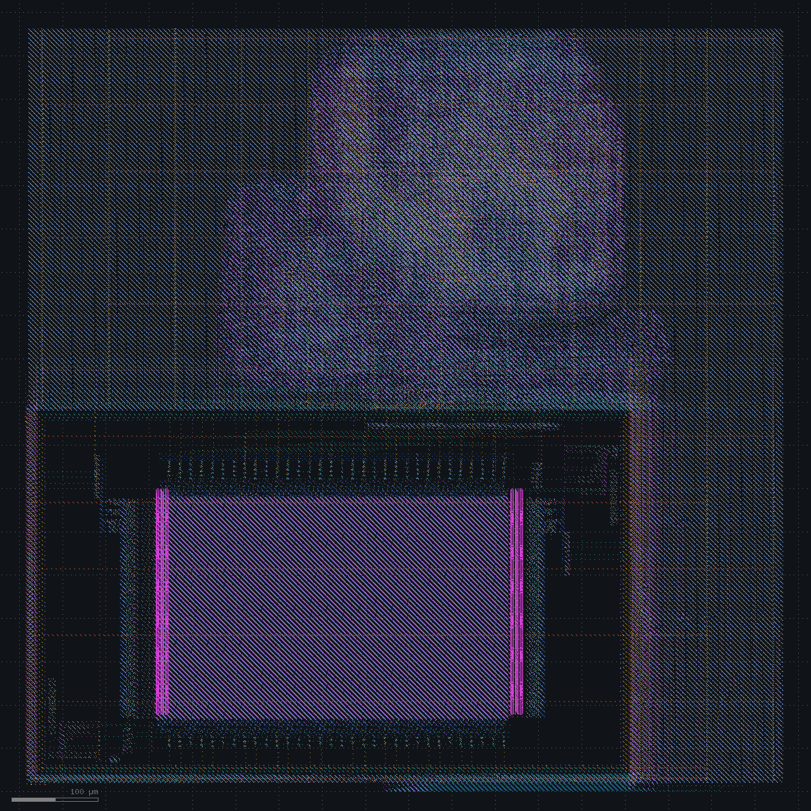
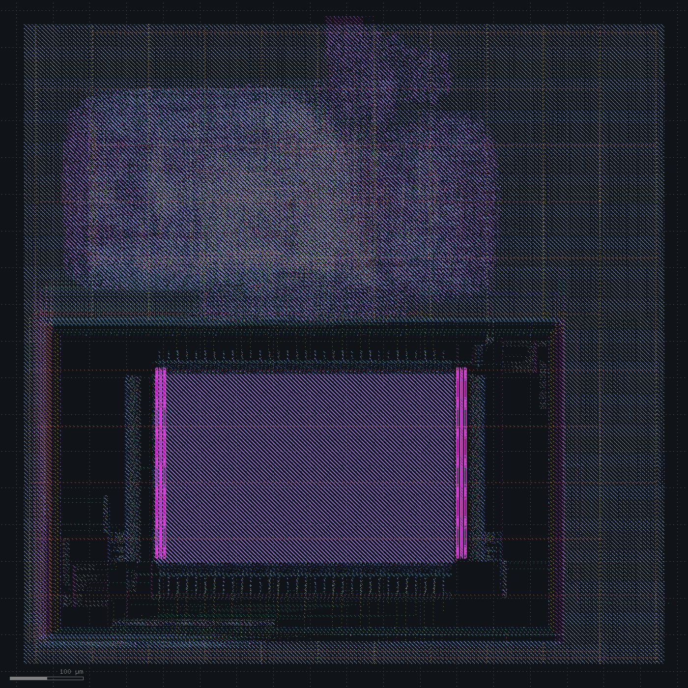
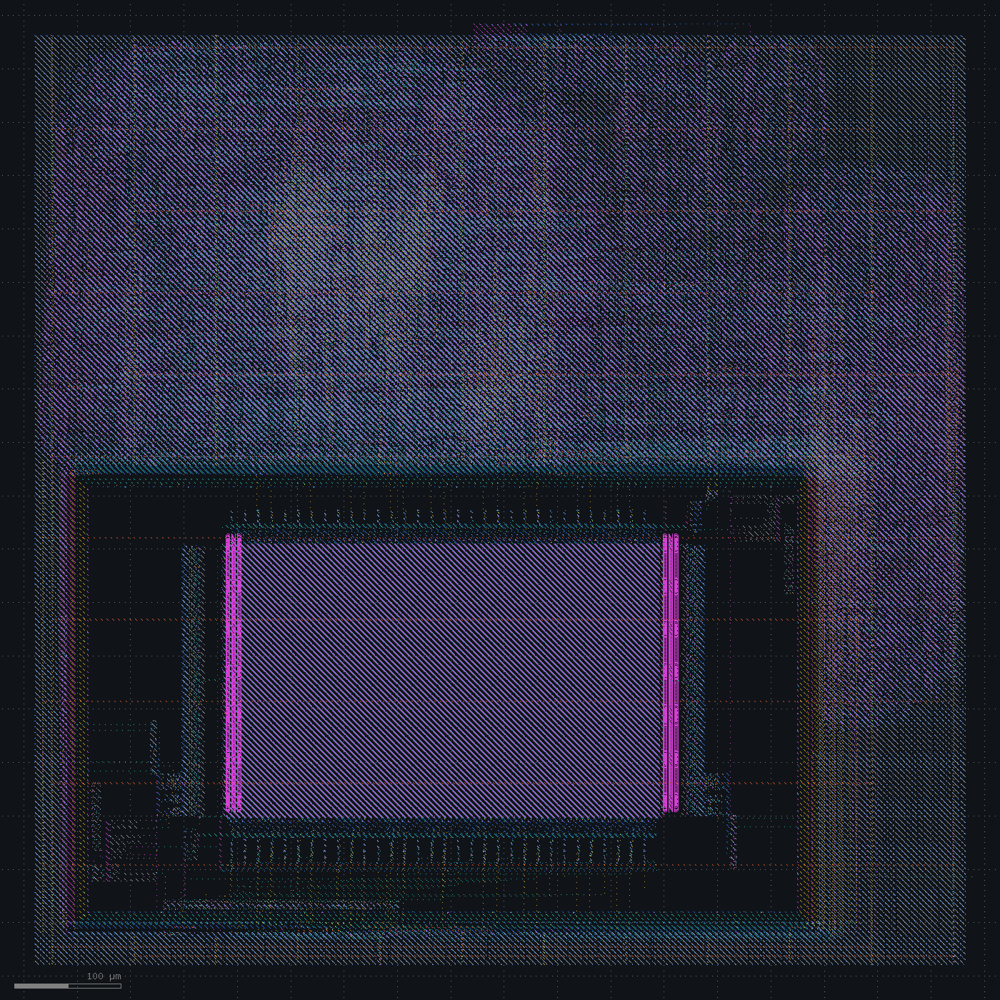

# Boot and peripherals

Spec: [spec_v1.md](../spec_v1.md). Target: 50 MHz at tt_025C_1v80.

RTL simulation boots the firmware from the flash model and passes all checks. Gate-level simulation of the synthesized netlist passes the same test.

Synthesis gives 9214 standard cells (96,048 µm²) plus the SRAM macro (284,538 µm²). The floorplan uses 50% utilization and aspect ratio 1, which gives an 892 x 892 µm die.

| Change | WNS (ns) | TNS (ns) | Magic DRC | LVS |
|---|---|---|---|---|
| Baseline | -10.06 | -9075 | 1943 | mismatch |
| SRAM placed by hand in the corner | routing failed | | | |
| Routing channels, pins off blocked edges | -8.86 | -8750 | 0 | mismatch |
| Setup repair after CTS, filler power pins | routing stopped | | | |
| Placement padding | -3.68 | -3406 | 0 | clean |

## Baseline

`rtl_macro_placer` put the SRAM in the lower-left corner, rotated R180. Global placement at density 0.6, `repair_design`, CTS, routing. No setup repair.

Routing finishes with 0 DRC. KLayout DRC is clean.

The worst setup path starts at SRAM `dout1[19]`, the fetch port. The macro launches read data from the falling clock edge, so the instruction appears at 11.71 ns, 10 ns into the cycle. It passes nine fanout buffers, decode, the register file read mux, the ALU and the register file write enable. Arrival is 31.50 ns against 21.44 ns required. The `nor2_2` cells that decode the write enable drive 25 loads each and cost up to 2.3 ns.

The post-CTS estimate said -4.67 ns. Signoff with OpenRCX parasitics says -10.06 ns.

Magic reports 1943 errors: LU.3 (939), LU.2 (927) and nwell.4 (77). They sit in a column of rows between the core's left edge and the SRAM halo, and in a strip below the macro. Those row fragments hold endcaps but no tap cells, and no met4 strap crosses them.

LVS fails on the same rows. In the layout the decap cells fall into 76 separate power groups, against one group in the netlist.

Decision: place the SRAM by hand.

## SRAM in the corner

The SRAM sits flush with the core's lower-left corner, unrotated, with the fetch port on its top edge facing the core.

Global routing fails with 4290 congestion violations over the macro, where the horizontal capacity is 0.

| Net group | Violations |
|---|---|
| `gpio_in` | 1212 |
| `gpio_oe` | 930 |
| `s0_rdata` (SRAM port 0 read data) | 804 |
| `gpio_out` | 679 |
| `s_wdata` (SRAM port 0 write data) | 345 |

`place_pins` ran before the macro was placed and put pins on the left and bottom edges, behind the SRAM. Port 0 has its data pins on the bottom edge, which now faces the die boundary.

Decision: move the SRAM 40 µm in from the left and bottom core edges, and keep I/O pins on the top and right edges.

## Routing channels

Global routing has no congestion and detailed routing ends with 0 DRC. Magic and KLayout are both clean. The channel rows reach the first met4 strap.

WNS improves to -8.86 ns. The worst path is the same: SRAM `dout1[19]` through decode, register file read and register file write.

LVS still fails, on `decap_3`. The 1430 `decap_3` fillers have no power connections in the netlist, because `filler_placement` runs after `global_connect`.

Decision: run `repair_timing -setup` after CTS, and `global_connect` after filler placement.

## Setup repair

`repair_timing -setup` after CTS inserts 197 buffers, upsizes 350 cells and clones 102. The post-CTS estimate moves from -4.69 ns to -0.06 ns.

Detailed routing ran for 3 hours on 2 to 3 of the 32 cores and was stopped. A copy of the same database, routed with progress logging, showed 46,166 violations after the first pass and 32,769 after the fourth, almost all met1 and met2 shorts. The cells sit edge to edge in one dense cluster and the router runs out of room to reach their li1 pins.

A trial at placement density 0.4 started at 29,718 violations and still had 4,192 after eight passes.

Decision: pad every cell by 4 sites in global placement and 2 sites in detailed placement.

## Placement padding

Global placement pads each cell by 4 sites and detailed placement by 2.

Detailed routing converges in 13 passes, from 25,111 violations to 0, in about 7 minutes.

| Check | Result |
|---|---|
| Routing DRC | 0 |
| Magic DRC | 0 |
| KLayout DRC | 0 |
| LVS | clean |
| Antenna | 102 nets |
| Hold | +0.077 ns |
| Power | 9.53 mW |

Setup fails: WNS -3.68 ns, TNS -3406 ns, 1209 failing endpoints, 42.2 MHz maximum.

Every one of the ten worst paths starts at SRAM `dout1[16]`, which arrives at 11.87 ns. They end at `pc` and register file flops, after decode, register file read, the ALU, and the next-PC or write-back logic. The failing endpoint count has stayed between 1209 and 1218 since the baseline.

## Status

The layout is DRC and LVS clean. Timing misses 50 MHz by 3.68 ns.

