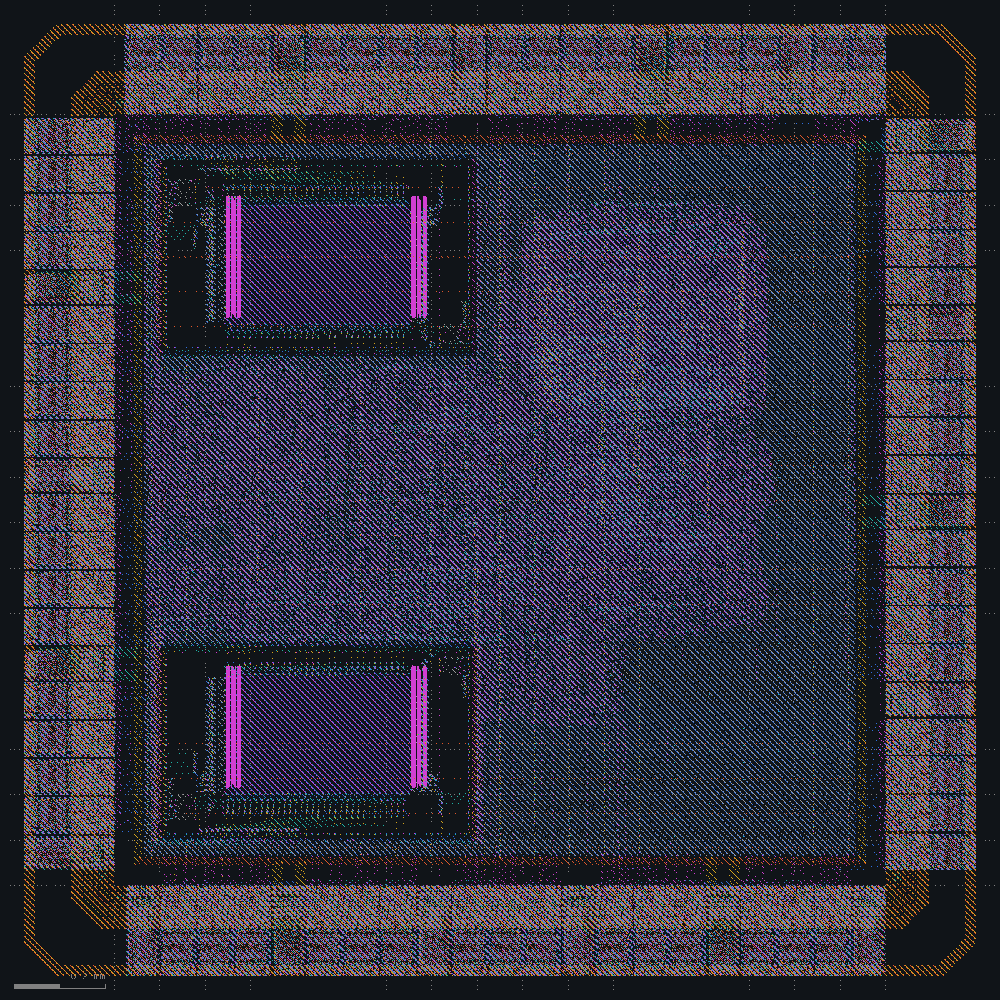
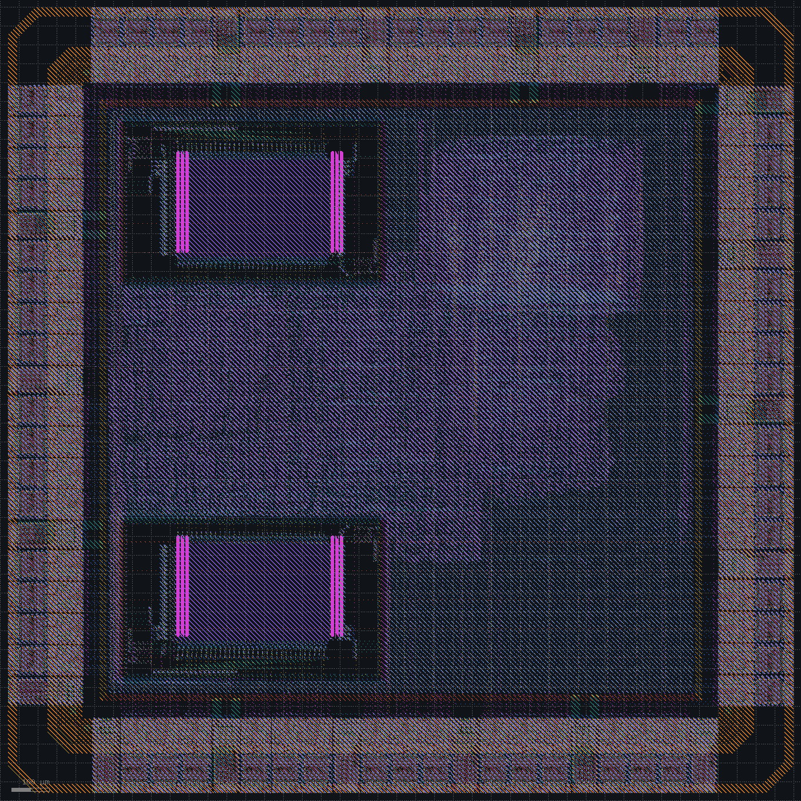

# Chip assembly

Spec: [spec_v7.md](../spec_v7.md). The SoC becomes a chip. The core sits inside a ring of SKY130 I/O cells: 64 `gpiov2` signal pads and 18 supply pads (VCCD, VSSD, VDDIO and VSSIO on every side, VDDA and VSSA on the south side), four corners, and bus slices in the gaps. One slice per side ties VCCHIB to VCCD and VSWITCH to VDDIO. `chip_top.v` instantiates the core and the signal pads; the floorplan places the supply pads, corners and slices, and draws straps from each VCCD and VSSD pad to a power ring around the core. GPIO and SDRAM data are bidirectional pads now, and the firmware turns the GPIO drivers on.

RTL simulation runs the chip with the PDK pad models and passes. Timing is checked at the chip pins, through the pad cells, with 5 pF on every output and 1 ns input edges.

| Change | Setup WNS clk / mclk (ns) | Failing endpoints | Hold WNS (ns) | Gate-level sim | DRC / LVS |
|---|---|---|---|---|---|
| Pad ring, 2.1 mm die | -2.87 / -2.22 | 39 | +0.075 | passes | 93 Magic, 15 KLayout / mismatch |
| Falling-edge SDRAM and SPI captures, met3 pad straps, seal ring, 2.12 mm die | +0.86 / +0.50 | 0 | +0.022 | passes | clean / clean |

## Pad ring

Synthesis gives 22,579 cells (813k µm²) and the 64 signal pads. The die is 2100 x 2100 µm, and the core inside the power ring is 1569 µm square at 36% utilization. Placement adds 811 tie cells for the pads' constant inputs.

Four things had to change before the flow went through:

- Yosys put a `buf_2` between each pad and the bit of the SDRAM address, bank or mask bus it drives. A pad's inout net can't merge with one bit of an output vector, and the flow turned the leftover assignment into a buffer. OpenROAD reads assignments, so synthesis keeps them.
- The first global route stopped with 469 congestion errors, all on the pads' analog buses `AMUXBUS_A` and `AMUXBUS_B`, which run through the cells by abutment. They are now special nets that the router skips.
- OpenSTA crashed in the power report, because the pad's `IN` function reads its own bidirectional `PAD` pin. It also reported 50 ns slews on every pad output, taken from the weak pull-up modes that the pad settings disable. Timing now reads a copy of the pad liberty with only the arcs those settings can enable and without the `IN` function.
- PDNGen connected the ring to the supply pads with a single 1.27 µm strap on the edge of a bus. The floorplan draws the straps instead: met4 from the pads' met3 pins on the north and south sides, met3 on the east and west sides, with via arrays onto the ring.

Setup fails on 39 endpoints, all but three at the pins:

| Path | Worst slack (ns) | Endpoints |
|---|---|---|
| SPI, UART and GPIO outputs | -2.87 | 20 |
| SDRAM read data | -2.22 | 16 |
| Multiplier sum, inside the core | -0.05 | 3 |

The outputs have 10 ns from the `clk` edge at the pin. The clock pad takes 1.45 ns, the tree 1.6 ns, the output pad 4.3 ns, and the board budget is 4 ns.

SDRAM read data reaches its flop 14.1 ns after the `mclk` edge at the pin: 5.8 ns to the `sdram_clk` pin through two pads and the clock tree, 6.4 ns of access time and board, 1.6 ns through the input pad and 0.4 ns of wire. The next rising edge reaches the flop at 12.4 ns. The data holds until about 21 ns, when the next edge's data can arrive, so the falling edge in between has room on both sides.

The SPI master samples MISO on the clock edge that raises SCLK. Through the pads, the flash's bit comes back about 13 ns after the falling edge that launched it, so the rising edge 10 ns later would take the previous bit. RTL and gate-level simulation pass because the flash model and the pad models have no delay.

Hold closes at +0.075 ns. Power without the pad cells is 49.4 mW, and IR drop is 1.89 mV. Antennas and router DRC are at 0.

Magic finds 93 errors (70 met5 width, 13 n-well tap, 10 via4 spacing). KLayout, on the GDS with the real pad cells, finds 6,466; 6,451 lie inside the SkyWater I/O cells and are waived in `signoff/waivers.txt`. The other 15 are via4 errors where a VGND stripe ends on the ring under the strap from the south VSSD pad, and the strap's via array lands on the stripe's vias.

LVS does not match: in the extracted layout every supply is one net. The VSSD pad's met3 pins reach 40 µm into the pad, under its met4 buses, and the met4 straps on the north and south sides start on them. Each of those straps covers the VCCHIB, VCCD, VDDA, VDDIO, VSSIO, VSWITCH and VSSA buses. Gate-level simulation passes with flops starting at 0 and at 1.

Decision: capture SDRAM read data on the falling edge of `mclk`, sample MISO on the falling SCLK edge, constrain SPI against a generated SCLK and treat UART and GPIO as asynchronous, run every pad strap on met3 out of the pad and via up only inside the ring, clear of other power shapes, and add a seal ring with the pad ring 20 µm in from a 2.12 mm die edge.

## Falling-edge captures, met3 straps, seal ring

The SDRAM port registers read data on the falling edge of `mclk` before the controller sees it, so a read returns one `mclk` cycle later. A copy of the controller that kept the old read latency hangs the firmware on its first jump into SDRAM. The SPI master samples MISO on the falling SCLK edge. The constraints now give the SPI pins a clock generated at `spi_sclk`, with two cycles for MISO, and treat UART, GPIO and reset as asynchronous. RTL simulation passes; the benchmark takes 13,237 cycles cold and 12,484 warm.

Every pad strap now runs on met3 out of the pad. On the north and south sides it climbs to the met5 ring through a met4 landing inside the ring, with room left around other met4 shapes. One pin of the east VSSD pad lies beyond the end of the ring and has no strap. The die grows to 2120 x 2120 µm, with the pad ring 20 µm in and the SkyWater seal ring from the PDK's generator in the outer 6 µm.

Synthesis gives 22,565 cells (814k µm²), and the core is at 37% utilization.

Timing closes: `clk` +0.86 ns (109.4 MHz), `mclk` +0.50 ns (105.3 MHz), hold +0.022 ns.

| Path | Worst slack (ns) |
|---|---|
| Inside the core, `clk` | +0.86 |
| SDRAM write data to `sdram_dq[15]` | +0.50 |
| SDRAM read data | +3.34 |
| SPI MOSI and CS | +6.94 |

One net breaks its limits: an `o21ai_0` drives three gates that timing repair cloned, at 2.23 ns slew against 1.48 ns and 0.08 pF against 0.05 pF.

Power without the pad cells is 50.4 mW and IR drop 1.99 mV. Antennas and router DRC are at 0. LVS matches. Magic's 31 errors all sit on the pad cells' LEF abstracts, which carry n-well and p-well obstructions with no taps and met5 bus edges narrower than the width rule; the Magic count now leaves out errors within 2 µm of a pad cell. KLayout finds nothing outside the I/O cells. With the seal ring checks on, it reports the errors inside each supply pad instance separately, so the waived count rises to 34,334. Gate-level simulation passes with flops starting at 0 and at 1.

## Status

The SoC is a chip: a 2.12 mm die with 82 pads and a seal ring. Timing closes from the pins at the typical corner, LVS matches, and the only DRC errors left are inside the SkyWater I/O cells.

| | Before | After |
|---|---|---|
| Form | 1361 x 1361 µm block | 2120 x 2120 µm chip, 82 pads, seal ring |
| `clk` | 100 MHz target, 104.6 MHz max | 100 MHz target, 109.4 MHz max |
| `mclk` | 124.2 MHz max, core to block pins | 105.3 MHz max, through the pads to the SDRAM |
| SDRAM read data | Rising-edge capture | Falling-edge capture, one more `mclk` cycle |
| Benchmark, cold | 13,192 cycles | 13,237 cycles |
| Power (mW) | 51.6 | 50.4, pad cells left out |

Open:

- Timing is checked at the typical corner only. The SRAM liberty exists for that corner alone.
- One net is over its slew and load limits after timing repair.
- IR drop takes every met5 node as a source instead of the supply pads.
- The layout has no metal fill.
