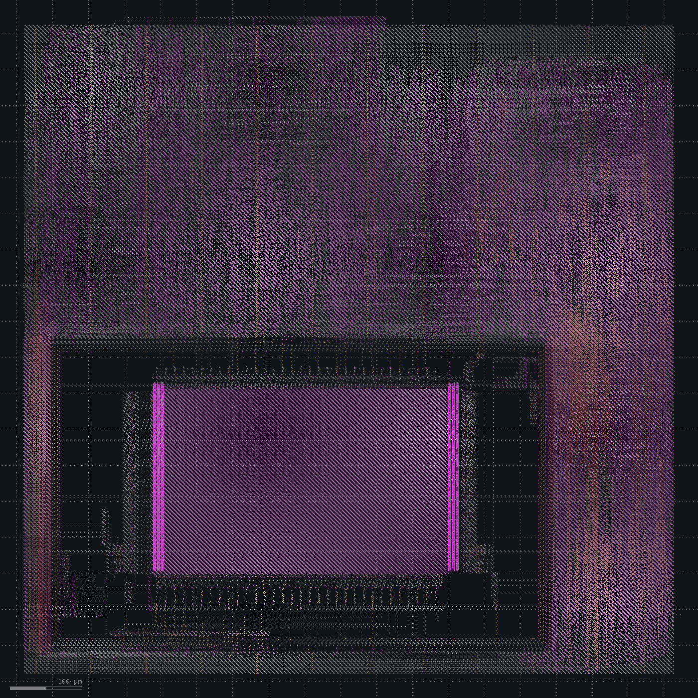

# External memory

Spec: [spec_v2.md](../spec_v2.md). Adds a 32 MB SDR SDRAM at `0x8000_0000`, driven by a controller on a second clock, `mclk` at 100 MHz. The system clock stays at 50 MHz.

The bus side is an AXI4-Lite slave on `clk`. Commands and responses cross to `mclk` through two async FIFOs with Gray-coded pointers. Each 32-bit word is one ACTIVE plus a READ or WRITE with auto-precharge and a burst of 2.

The testbench has an SDRAM model that checks protocol rules. The firmware writes and reads back 16 words in four rows across three banks, then checks byte and halfword stores. RTL and gate-level simulation pass with 0 protocol errors. Two deliberate bugs make the test fail: capturing read data one cycle early, and dropping auto-precharge (290 protocol errors).

The SDRAM pins are timed against the forwarded clock `sdram_clk` with MT48LC16M16A2-75 numbers: tIS 1.5 ns, tIH 0.8 ns, tAC 5.4 ns, tOH 2.7 ns, and a 1 ns board round trip. The two clock domains are asynchronous.

| Change | Setup WNS clk / mclk (ns) | Hold WNS (ns) | Hold failures | DRC / LVS |
|---|---|---|---|---|
| SDRAM port | +5.38 / +3.39 | -0.256 | 32 | clean |
| Hold repair | +5.38 / +3.39 | -0.222 | 32 | clean |
| SDRAM pins launched on the falling edge | +4.50 / +2.14 | +0.074 | 0 | clean |
| Bounded clock-crossing constraints | +4.50 / +2.14 | +0.074 | 0 | clean |

## SDRAM port

The die grows to 921 x 921 µm. Power rises from 11.5 to 16.2 mW.

Setup closes in both domains: 68.4 MHz for `clk` and 151 MHz for `mclk`.

Hold fails on 32 endpoints, all of them SDRAM outputs. On `sdram_cas_n`, the launching flop's clock arrives at 1.19 ns through four levels of the `mclk` tree, and the pin switches at 1.57 ns. The forwarded clock leaves the die through a shorter path and reaches `sdram_clk` at 0.76 ns. The SDRAM needs the old value held until 0.76 + 0.8 + 0.25 = 1.81 ns.

The flow has no hold repair.

Decision: run `repair_timing -hold` after CTS and after global routing.

## Hold repair

After CTS, `repair_timing -hold` finds 3 endpoints and inserts 3 buffers. After global routing it finds none. Signoff still fails hold on the same 32 SDRAM outputs, by up to 0.222 ns.

The pre-route estimate has the clock tree far from what gets built. On `sdram_cke`, `mclk` reaches the launching flop at 4.23 ns in the estimate and at 1.18 ns after extraction. The estimate puts 0.57 pF on the `mclk` input net and 1.10 pF on the first clock buffer. Output hold depends on the difference between the internal tree and the forwarded clock, so the estimated slack is +1.20 ns while the extracted slack is -0.11 ns.

A trial on the same database repaired hold after detailed routing with OpenRCX parasitics. It found 38 failing endpoints and inserted 3 buffers.

Decision: register the SDRAM pins on the falling edge of `mclk`.

## Falling-edge SDRAM pins

A stage of 39 flops on the falling edge of `mclk` sits between the controller and the SDRAM pins. The SDRAM still samples each command on the same rising edge, so the controller sequencing does not change. Yosys maps these flops to `dfxtp_2` behind a clock inverter. RTL and gate-level simulation pass with 0 protocol errors.

| `sdram_cas_n` | Rising edge | Falling edge |
|---|---|---|
| Hold slack (ns) | -0.24 | +4.60 |
| Setup slack (ns) | about +7 | +2.50 |

Hold has no failing endpoints. The `mclk` domain WNS of +2.14 ns is now the output setup on `sdram_a[11]`. `clk` closes at 64.5 MHz and `mclk` at 127 MHz. DRC and LVS are clean, with 74 antenna nets.

The two clock domains are still declared asynchronous, so no path between them is timed.

Decision: replace the asynchronous clock groups with a 10 ns `set_max_delay -ignore_clock_latency` in both directions and a false path for hold.

## Bounded clock crossings

Both directions are now timed. Signoff writes the worst crossing paths to `cdc.rpt`.

| Crossing | Endpoints | Worst slack (ns) |
|---|---|---|
| `clk` to `mclk` | 66 | +8.42 |
| `mclk` to `clk` | 998 | +5.45 |

The 998 endpoints on the `mclk` to `clk` side are response FIFO data passing through the CPU load path into the 992 register file bits.

Every crossing starts at a FIFO memory flop or a pointer flop. Each synchronizer input is one source flop ANDed with the destination domain's synchronized reset, so no synchronizer samples logic built from more than one asynchronous bit. The Gray-code MSB flop is merged with the binary MSB flop, which has the same D input.

The implementation does not change: timing, power and area match the falling-edge layout.

## Status

The SDRAM port works in RTL and gate-level simulation. Setup closes at 64.5 MHz on `clk` and 127 MHz on `mclk`, hold has no failures, and the clock crossings are constrained and met. DRC and LVS are clean.

Open: 74 antenna nets. Global routing reports one tile over capacity by one track at (745, 462) µm, which detailed routing clears. The die is 923 x 923 µm.

