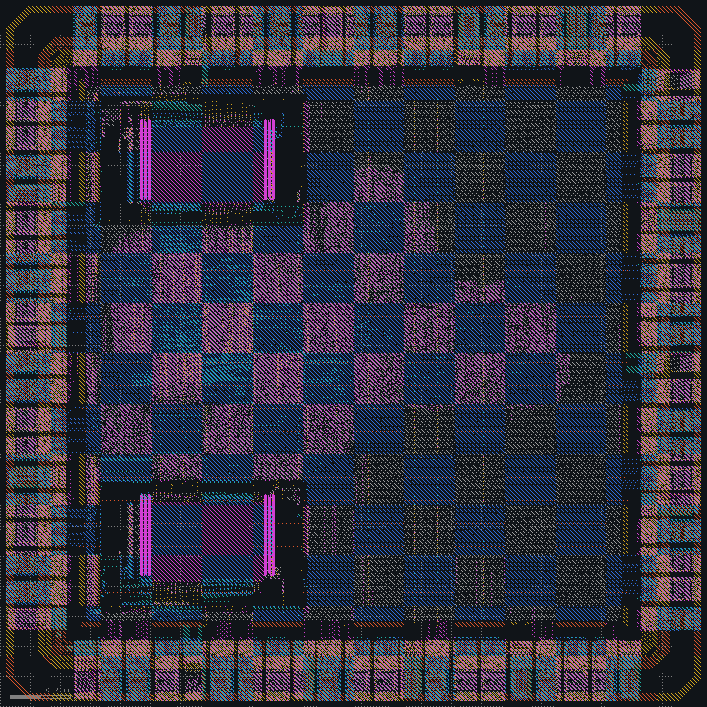
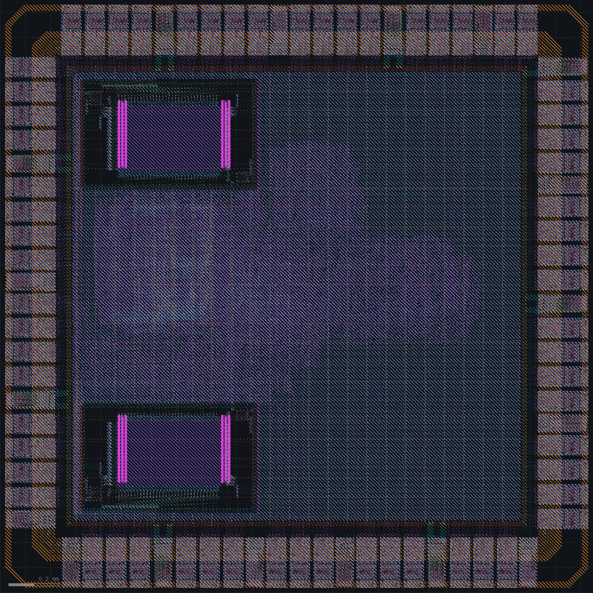
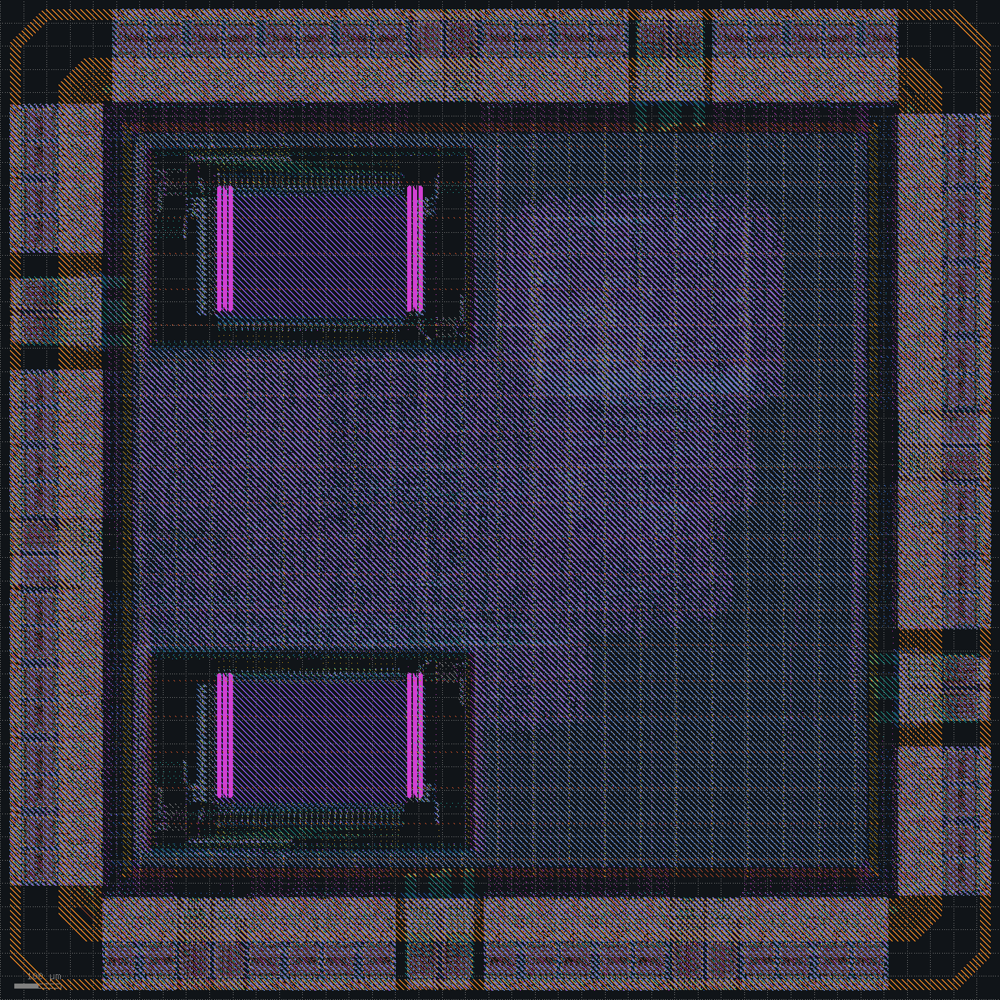
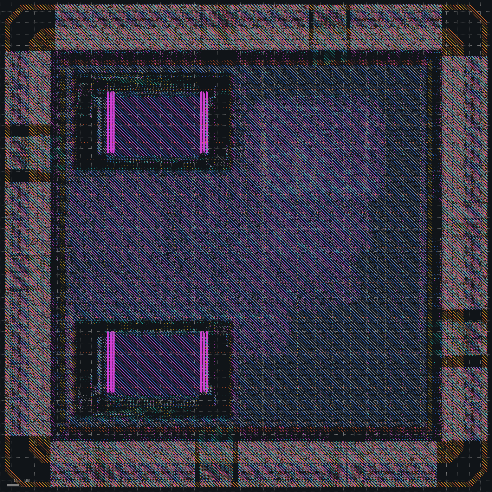

# Fab readiness

Spec: [spec_v9.md](../spec_v9.md). The chip is a standalone die, and its GDS has to pass a foundry's own checks with nothing waived. That adds checks the flow did not have: KLayout DRC over the whole GDS with the I/O cells included, electromigration on the power grid, equivalence of the routed netlist, Magic DRC on the full GDS, and the PDK's density windows.

| Change | Die (mm) | Setup WNS clk / mclk, tt (ns) | Setup WNS clk / mclk, ss (ns) | Hold WNS tt / ff (ns) | KLayout DRC |
|---|---|---|---|---|---|
| Pads spaced by measured distances | 2.35 | +0.99 / +0.50 | +1.97 / +1.59 | +0.181 / +0.016 | 0 |
| 3.2 µm met4 and met5 stripes | 2.35 | +0.98 / +0.51 | +1.94 / +1.60 | +0.168 / +0.013 | 0 |
| Pad ring after the SkyWater I/O guide | 2.15 | +0.67 / +0.61 | +1.46 / +1.74 | +0.162 / -0.003 | 0 |
| 0.3 ns hold margin | 2.15 | +0.89 / +0.62 | +1.41 / +1.77 | +0.190 / +0.015 | 0 |

## Pad ring seams

The 34,334 KLayout errors counted as inside the SkyWater I/O cells were checked against the PDK cells on their own. One of each pad cell, placed apart, gives 16 errors. The rest came from how the ring put the cells together:

- `gpiov2` pads abutting: 28,770. Their wells reach past their LEF outline.
- The `vccd` and `vssd` pads: about 3,300. An overlay reaches about 11 µm past the outline onto the neighbour's vias.
- Other seams: about 1,000, at the 1 µm slices and the high-voltage pads.

Rows of PDK cells checked with the same deck give the clean distance for each pair of neighbours: 12 µm between `gpiov2` pads and between a `gpiov2` and a `vccd` or `vssd` pad, 5 µm next to the high-voltage pads. With those gaps the ring needs a 2.35 mm die.

Decision: space the pads by the measured distances on a 2.35 mm die.

## Spaced pads

KLayout finds no error on the whole GDS, pad cells included, and nothing is waived. Timing closes at all three corners; IR drop is 19.9 mV.

PDNSim's segment currents, checked against the average-current limits in the tech LEF (90 °C), pass on every wire. Two via4 crossings carry 2.96 and 3.09 mA per cut against 2.49 mA.

Decision: widen the met4 and met5 stripes from 1.6 to 3.2 µm.

## Wider stripes

No segment is over its limit, and IR drop falls to 13.3 mV. Timing and DRC stay where they were.

SkyWater's `sky130_fd_io` user guide sets three rules for the ring: cells cannot be abutted with each other in general, GPIO cells must be mirrored and placed by abutment, and supply pads come in pairs, because each has only one side that meets the rules towards a GPIO. The spaced ring breaks the last two.

Decision: rebuild the ring to the guide.

## Pad ring after the SkyWater I/O guide

- `gpiov2` pads abut, every other one mirrored.
- `vddio` with `vssio`, and `vdda` with `vssa`, sit back to back, the second one mirrored.
- `vssd` and `vccd` abut on their compliant sides. Their other sides carry the overlay, so each keeps a bus slice of at least 12 µm there.
- One slice per side ties VCCHIB to VCCD and VSWITCH to VDDIO; bus slices fill what is left.

Rows of PDK cells in each of these arrangements give no KLayout error. The die is 2.15 mm.

Setup closes at all corners, with `clk` at 107.1 MHz and `mclk` at 106.5 MHz at tt. Hold at the fast corner fails on one endpoint by 0.003 ns.

Repairing hold against the typical and fast corners in one OpenROAD session fails: with both corners defined, the clocks forwarded through the pads get the wrong latency, OpenSTA reports -0.977 ns of hold at tt, and repair adds 1,545 hold buffers.

Decision: repair hold at the typical corner with 0.3 ns of margin.

## 0.3 ns hold margin

| Corner | Setup, worst (ns) | Hold, worst (ns) |
|---|---|---|
| tt, 100 MHz | +0.62 `mclk`; +0.89 `clk` (109.8 MHz max) | +0.190 |
| ss, `clk` 50 MHz, `mclk` 62.5 MHz | +1.41 `clk` (53.8 MHz max); +1.77 `mclk` | +0.639 |
| ff, 100 MHz | +1.48 | +0.015 |

Hold repair adds 44 buffers at CTS and 14 after global routing. No pin is over its slew limit apart from the waived SRAM inputs, and `dout1[16]` is the only pin over its load limit: its net to a buffer 13 µm away is routed about 460 µm around the SRAM pin row, and paths through it keep 3.81 ns of setup slack at tt and 7.70 ns at ss.

Power without the pad cells is 50.4 mW, and IR drop is 11.5 mV. Antennas and router DRC are at 0, LVS matches, and KLayout finds nothing. The routed netlist runs the test with the signoff delays and passes in 11.93 ms: 13,233 cycles cold and 12,484 warm, with no SDRAM protocol error.

Three checks a foundry relies on are still missing from the flow:

- The routed netlist is not proven equivalent to the synthesized one. On the 2.35 mm layout, Yosys's `equiv_simple` on the flattened netlists left 2,595 points unproven. Each sits on a gate whose interchangeable inputs timing repair swapped, A1 and A2 of `_26732_` for example, and matching on cell-pin names reads the swap as a difference.
- Electromigration is checked by hand.
- The PDK's density check, `check_density.py`, looks at every 700 µm window on diffusion, li and the five metals. With metal fill alone, met1 to met4 are under 35% in nearly every window, met5 under 45%, and diffusion under 33% in 147 windows.

Decision: prove the routed netlist equivalent with flops, SRAMs and pads as cut points, check electromigration and list the bond pads in the flow, and fill every layer with the PDK's fill generator.

## Equivalence, electromigration, bond pads, fill

`make lec` turns the flops, SRAMs and pads into cut points matched by instance name, builds a miter of the synthesized and routed netlists, and ABC proves it unsatisfiable in about a second: 4,650 inputs and 66,358 AND nodes. Every flop input and clock pin, every output and every SRAM and pad input agrees, and the clock pins show the clock tree is buffers only. A copy of the routed netlist with one `o21ai` changed to an `a21oi` comes back satisfiable.

`make em` checks PDNSim's segment currents against the tech LEF limits: wires by the metal width across the segment, vias by the cuts where the two metals overlap. Nothing is over. The highest loads are via4 at 36.9% of its limit and met4 at 27.5%.

`make pads` lists the 82 pad openings, 60 x 70 µm each, with the pin or supply and the centre, numbered counter-clockwise from the south-west corner.

The GDS step fills with the PDK's generator (`generate_fill.py`, Magic's wafflefill style) on diffusion, poly, li and met1 to met5, on the drawing layer numbers with datatype 99. Fill-block layers keep it off the seal ring band, the I/O cells, and the SRAMs below met4. The generator's tiles run past the die, so only fill wholly inside the die stays.

On the filled GDS:

- KLayout's deck finds no error. It reads the drawing datatypes only, so a copy with the li and metal fill moved onto them went through the BEOL rules as well, and they find none. The diffusion and poly fill keep their spacing to drawn diffusion, poly and contacts, no poly fill crosses diffusion, and no diffusion fill sits in an n-well.
- The PDK's zero-area and pin-label checks find nothing.
- KLayout's density deck passes, with 44 to 65% of the die clear on li1 and every metal.
- In `check_density.py`'s windows, met4 and met5 now meet their minimums everywhere. Of the 484 windows, met1, met2 and met3 are under 35% in 304, 280 and 161, diffusion is under 33% in 109, and li is under 35% in 26 and over 60% in 270, over the SRAMs and the densest logic. Across the die met1 is at 34.6% and every other layer is within its range.

SkyWater's periphery rules list pattern density for met1 to met4 only, as recommended rules that the foundry's own waffle fill implements, and have none for diffusion or li.

## Magic on the full GDS

Magic's DRC on the whole GDS, read the way the PDK's own DRC script reads it, reports 11,511,209 errors on the layout before the PDK fill. 11,147,232 are inside the SRAMs, which give 5,579,000 each on their own. The core and its routing have none.

Each of the remaining 363,977, in the I/O cells and the seal ring, was mapped into its cell's own coordinates and compared with Magic on the bare PDK cells and on the generated seal ring: 337,436 match on rule and place. The rest come from Magic's hierarchical check. The seal ring cell spans the die, so every pad is re-checked flattened against it; the largest group is Magic's rule that some layers can't partially overlap between subcells.

To check what the ring's assembly adds, windows around each of the 34 kinds of pad junction and corner were cut out, flattened and checked. Everything there is in the flattened bare cells, the seal ring, or at a window's cut, except one rule: at the mirrored `gpiov2` seams, Magic wants 2.0 µm between high-voltage n-wells and finds 1.44 µm. The two wells are the same isolation ring in neighbouring pads on the shared pad bus, the spacing comes from the guide's mirrored abutment, and the PDK's KLayout deck checks n-well spacing at 1.27 µm.

On the filled GDS Magic reports 11,525,414. Outside the SRAMs every one of its errors lies on an error of the same rule from before the fill, so the fill adds none.

## Status

The GDS passes the PDK's KLayout DRC, density, zero-area and pin-label checks with nothing waived. The ring follows SkyWater's I/O guide, every layer carries fill, the routed netlist is proven equivalent to the synthesized one, the power grid stays within its current limits, and the routed netlist passes the test with signoff delays.

| | Before | After |
|---|---|---|
| Die | 2.12 mm; ring with 34,334 KLayout errors waived | 2.15 mm; ring to SkyWater's I/O guide, no KLayout error |
| `clk` | 108.4 MHz max at tt, 55.3 MHz at ss | 109.8 MHz at tt, 53.8 MHz at ss |
| `mclk` | 107.0 MHz max at tt, 70.7 MHz at ss | 106.5 MHz at tt, 70.3 MHz at ss |
| Hold, worst (ns) | +0.167 at tt, +0.007 at ff | +0.190 at tt, +0.015 at ff |
| IR drop | 17.1 mV | 11.5 mV |
| Electromigration | not checked | every power-grid segment within its limit, worst 36.9% |
| Equivalence | netlists agree in simulation | routed netlist proven equal to the synthesized one |
| Fill | met1 to met5, KLayout squares | every layer, PDK generator |
| Bond pads | not listed | 82 openings with pins and centres |

Open:

- The RTL and the synthesized netlist are not proven equivalent; they agree in simulation.
- `check_density.py` windows on met1 to met3, diffusion and li stay outside its targets in part of the die.
- One SRAM output, `dout1[16]`, drives more than its liberty's largest load and is waived.
- The SRAM slow and fast corners are scaled from its typical liberty.
- Power leaves out the pad cells.
- Extraction does not see the fill.
- In the SDF simulation the SRAMs use one read delay from their liberty, not annotated values.
