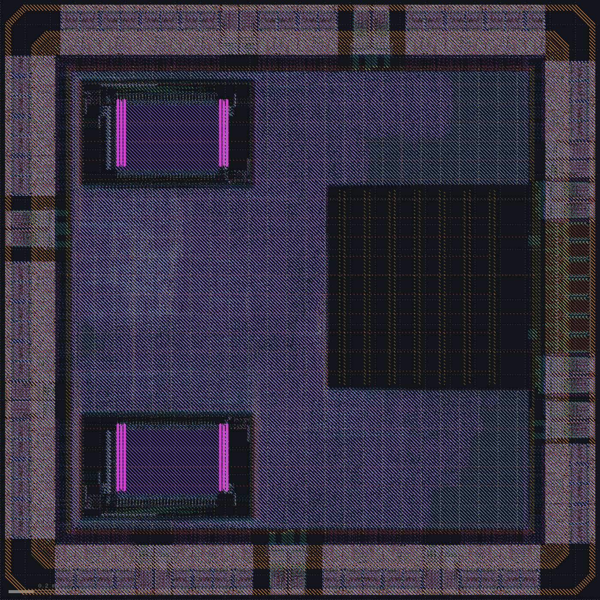

## Layout with the PHY macro

The branch takes the on-chip-variation work from `pcie-x1` first: the 5% derate, wire RC from the tech LEF, repair at the fast and slow corners, one output enable per SDRAM data pad and the output-pad drivers next to their pads. The RTL test passes on the result.

The 64 digital pads, the 7 analog pads and two AVSS/AVDD pairs fit a 2.4 mm die. The PCIe group sits in the middle of the east side, between SDRAM data pads, and each AVSS/AVDD pair keeps a 12 µm bus slice on its outer sides like VSSD/VCCD.

The macro sits against the east edge of the core, centred on its pads. Its lane pins sit at the analog pads' 75 µm pitch, so each lane runs straight to its pad, and its PIPE pins face the logic. The core grid reaches its VCCD and VSSD stripes through met5. AVDD and AVSS run on met4 buses between the core ring and the pads: met3 straps join the clamped3 pads' VCCD1 and VSSD1 pins to them, and pass under the core ring onto the macro's bars.

With a 20 µm channel between the macro and the core edge, rows still ran through the channel, and pdngen added channel-repair straps there with vias to every rail. The analog straps crossed those vias.

Decision: the macro against the core edge, so no rows reach the ring in its height.

The first layout came out with six problems:

| Problem | Cause | Fix |
|---|---|---|
| CTS skipped `pclk`; 2,446 hold endpoints on global routes | MaxPCLK was a clock pin in the LEF and liberty, and OpenROAD takes only a signal pin as a net's driver | a signal pin, without a clock attribute or a timing arc |
| LVS: netlists did not match around the macro | the black box read from SPICE listed `rx_data[0]` first, the Verilog connects buses most significant bit first, and netgen pairs them in order | the black box built from the Verilog instance, as for the SRAM |
| Equivalence did not run | Yosys had no analog pad | the PDK's pad models as black boxes; the analog pads, which hold no logic, out of the miter |
| One via over its EM limit | PDNSim put the via's met4 node 4 µm from the met5 stripe, and the check looked at that node only | the check looks across both nodes |
| Setup -0.10 ns at tt on the SRAM read paths | repair on global routes saw those paths 0.09 ns better than extraction | 0.15 ns of setup margin in that repair |
| The analog pads empty in the GDS, seen in the layout picture | their layouts are in `sky130_ef_io__analog.gds`, which the stream-out did not read; DRC, density and LVS cannot see a cell with nothing in it | the stream-out reads it, and stops if any cell it places has no layout |

Timing closes at every corner with the 5% derate:

| Corner | Setup, worst (ns) | Hold, worst (ns) |
|---|---|---|
| tt | +0.13 `clk` (101.3 MHz); `mclk` +0.17 (101.7 MHz); `pclk` +8.22 | +0.219 |
| ss | +0.23 `clk` (50.6 MHz); `mclk` +1.06 (66.9 MHz); `pclk` +0.56 (64.8 MHz) | +0.563 |
| ff | | +0.052 |

The `pclk` figures include the PIPE paths into and out of the macro. Power without the pad cells is 76.3 mW, 10 mW of it the placeholder's assumed leakage, and IR drop 15.5 mV. Electromigration, antennas, router DRC, KLayout, the density deck, LVS and equivalence are clean, and Magic finds nothing outside the I/O cells. The 44 SRAM inputs over the slew limit stay waived. The pad list has 71 signal pads, 7 of them analog, and 22 supply pads.

The GDS holds the placeholder: an outline with pins. A chip that links to a device needs a licensed PHY in its place, as [hard_phy.md](../hard_phy.md) sets out.

Decision: the layout in `reports/45-phy-macro` is the PCIe PHY chip.
