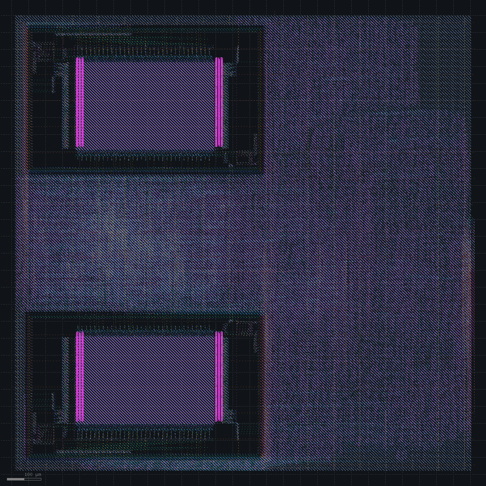

# PCIe removed

Spec: [spec_v6.md](../spec_v6.md). The PCIe port, its PIPE pins and `pclk` are gone. The interconnect has three slaves again and the APB bridge five. The firmware drops the PCIe test, and the testbench drops the endpoint and PHY models. RTL simulation passes, and the benchmark takes the same 13,192 cycles cold and 12,484 warm as before.

| Change | Setup WNS clk / mclk (ns) | Hold WNS (ns) | Gate-level sim | DRC / LVS |
|---|---|---|---|---|
| PCIe removed | +0.44 / +1.95 | +0.066 | passes | clean |

## Spec v6

Synthesis gives 22,104 cells (810k µm²) and 3,830 flops, down from 27,890 cells and 5,691 flops with PCIe. The die is 1361 x 1361 µm at 45% core utilization.

Timing closes: `clk` +0.44 ns (104.6 MHz), `mclk` +1.95 ns (124.2 MHz), hold +0.066 ns. The closest `clk` paths are SRAM loads into the register file. The slew and load violations from before are gone, `u_sram.mem/dout1[10]` included. The only pins over a limit are the 44 waived SRAM inputs.

Power is 51.6 mW and IR drop 2.63 mV. Antennas and router DRC are at 0, Magic and KLayout DRC are clean, and LVS matches. Gate-level simulation passes with flops starting at 0 and at 1.

## Status

The SoC is back to the CPU, caches, peripherals and SDRAM port, and closes at 100 MHz in the typical corner with 0.44 ns to spare.

| | Before | After |
|---|---|---|
| PCIe | Gen1 x4 root port | none |
| Pins | 424 | 113 |
| `clk` | 100 MHz target, 102.4 MHz max | 100 MHz target, 104.6 MHz max |
| Die (µm) | 1423 x 1423 | 1361 x 1361 |
| Standard-cell area (µm²) | about 317k | about 241k |
| Power (mW) | 67.9 | 51.6 |

Open: timing is checked at the typical corner only, and the layout is a block with no pad ring.
