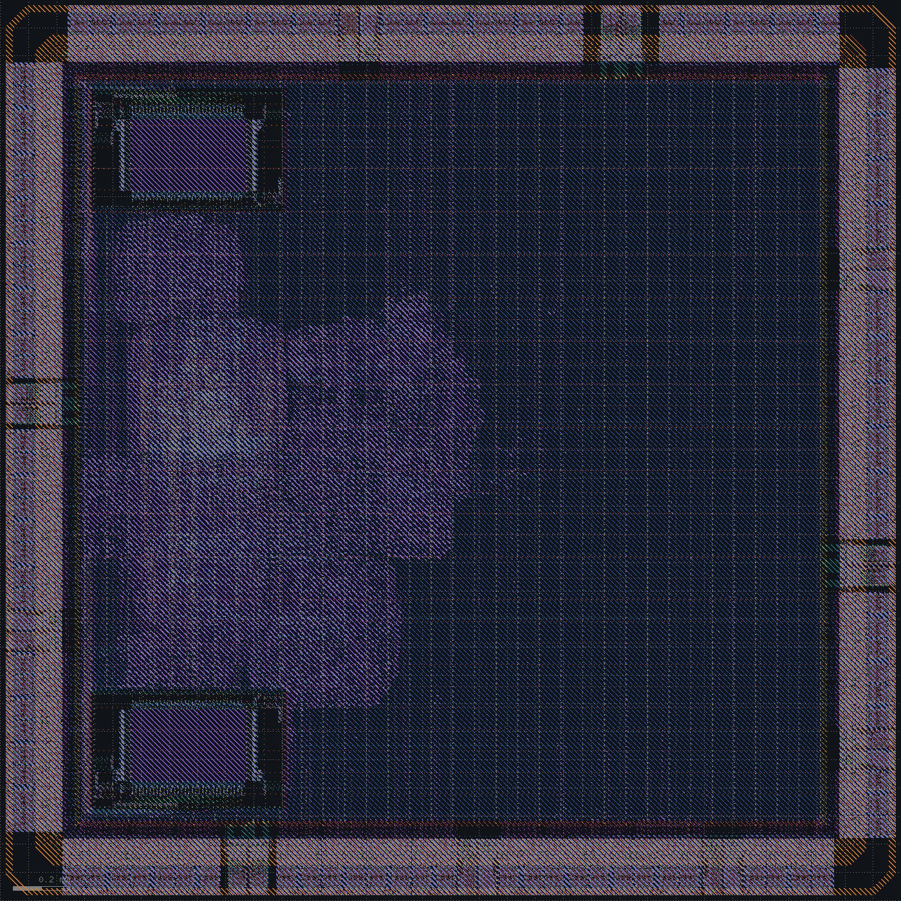

# PCIe x1 port

Spec: [spec_v6.md](../spec_v6.md). The x4 port becomes an x1 root port for a real PHY, the TI XIO1100, inside the standalone chip from `main`.

## Branch base

The branch starts from the SoC with the x4 port and takes the chip work from `main`: the pad ring, the seal ring, three-corner signoff, fill, equivalence and electromigration checks. The x4 PIPE has 311 pins, more than a pad ring can carry, so `chip_top` passes it to the chip edge without pads.

RTL simulation of the chip with the pad models passes, PCIe included. Synthesis gives 887k µm² and 5,706 flops.

## PHY interface voltage

The XIO1100's TI-PIPE pins run at 1.5 or 1.8 V, and its inputs take no more than its own I/O supply. The PDK has `gpiov2` libraries with VDDIO at 3.3 V and at 1.65 to 1.95 V:

| Pad library | Output into 5 pF, rise / fall (ns) | Output edges (ns) | 1.8 V input, 1 ns edge (ns) |
|---|---|---|---|
| tt, VDDIO 3.3 V | 3.97 / 4.10 | 1.41 / 1.21 | 1.87 / 1.65 |
| ss, VDDIO 3.0 V | 6.07 / 6.20 | 2.35 / 1.84 | 2.96 / 2.60 |
| ff, VDDIO 5.5 V | 2.37 / 2.31 | 0.89 / 0.75 | 1.33 / 1.16 |
| ss, VDDIO 1.65 V | 13.86 / 16.17 | 6.49 / 5.00 | 2.96 / 2.58 |
| ff core, ss I/O, VDDIO 1.95 V | 8.61 / 9.95 | 3.63 / 3.10 | 1.52 / 1.44 |

At 1.65 to 1.95 V the outputs take 9 to 16 ns, more than the 8 ns clock period. In the 1.8 V input mode (`IB_MODE_SEL` 1) the input buffer runs from VCCHIB and reads 1.8 V levels with the ring at 3.3 V.

Decision: keep the ring at 3.3 V, read the PHY's outputs in the 1.8 V input mode, and drive its inputs through 3.3 V to 1.8 V translators on the board.

## Interface timing on paper

Transmit data leaves falling-edge registers and `pipe_tx_clk` is the clock forwarded through the same kind of pad, so the pad delay cancels. Receive data is captured on the falling edge of `pipe_rx_clk` after its own input pad. The budget assumes 0.3, 0.5 and 0.2 ns of clock skew between the PHY pin registers, 1.2, 2.2 and 0.8 ns of clock insertion from the pad, 0.5 ns of translator skew and 0.1 ns of trace mismatch.

| Corner | TX setup (ns) | TX hold (ns) | RX setup (ns) | RX hold (ns) |
|---|---|---|---|---|
| tt | 1.31 | 3.34 | 2.73 | 3.35 |
| ss | 0.78 | 3.44 | 3.59 | 2.35 |
| ff | 1.67 | 3.26 | 2.37 | 3.75 |

The pins close at every corner. The link runs on `pclk`, half of `pipe_rx_clk`, and has to close 62.5 MHz at the slow corner as well, since a PCIe clock cannot slow down. The x4 link reached 93.6 MHz at the typical corner, and on `main` the CPU runs at 109.8 MHz typical and 53.8 MHz slow.

The 51 PHY pins bring the ring to 115 signal pads. With the supply pairs that is about 35 pads a side and a die of about 3.3 mm.

Decision: 16-bit words at 125 MHz paired into 32 bits on `pclk`, a link pipelined for 62.5 MHz at the slow corner, and a pad ring of about 3.3 mm.

## x1 root port in simulation

The x4 link is replaced by an x1 root port in five parts:

- `pcie_pipe`: the `pipe_rx_clk` front end. It captures the PIPE inputs on the falling edge, pairs words for `pclk`, divides the clock, and drives the outputs from falling-edge registers.
- `pcie_ltssm`: the Downstream Port LTSSM, with an ordered set parser that realigns on every COM.
- `pcie_dll`: the data link layer. It accepts packets at any symbol position, checks the LCRC one DW per clock, and keeps a four-entry retry buffer with flow control.
- `pcie`: the transaction layer with its CPU windows and registers.
- `chip_top`: 51 more pads, the PHY inputs on the 1.8 V input buffer.

The test runs against two models written from the base specification and the XIO1100 data manual, apart from the RTL:

- An XIO1100 with real 8b/10b, a lane whose polarity can be swapped, and an elastic buffer that adds and removes SKP symbols.
- An endpoint with its own LTSSM, data link layer, finite credits, a Type 0 header and a 4 KB BAR.

The endpoint computes the LCRC and DLLP CRC the way the specification draws them. Its LCRC bytes for "123456789" are 26 39 F4 CB, the complement of the CRC-32 check value CBF43926, low byte first.

With the PHY out of reset at 2.60 ms, the link reaches L0 70 µs later. Most of that is the 1,024 TS1 ordered sets of Polling.Active. The firmware then:

1. reads RRS twice, then vendor and device ID C0DE5A5Ah;
2. reads all ones from a missing device;
3. sizes BAR0 at 4 KB and maps it;
4. writes and reads eight words and a byte.

ERROR stays at 0 and no TLP is replayed. The benchmark runs in 13,214 cycles cold and 12,484 warm. The synthesized netlist passes the same test in gate-level simulation.

| Fault | What the root does |
|---|---|
| Bad LCRC on the endpoint's third TLP | Nak; the endpoint replays |
| Nak of the root's fifth TLP | One replay |
| Ack withheld for the sixth TLP | The replay timer replays it 112 µs later; the endpoint Acks the duplicate |
| Endpoint enters Recovery | Recovery and back to L0, one count in STATUS |
| Decode error in a received packet | Packet dropped, Nak, endpoint replays |
| Lane polarity swapped | RX_POLARITY in Polling.Active, training time unchanged |
| Endpoint clock 250 ppm slow | The PHY adds SKP symbols; no effect on the link |
| MRd, MWr and a Message from the endpoint | UR completion for the MRd, the others dropped, ERROR bit 8 |
| Hot Reset from CONTROL | Link down, back in L0 2.07 ms later, the device enumerated again with its BAR cleared |

Each of these RTL changes makes the test fail with an endpoint violation:

| RTL change | Caught as |
|---|---|
| LCRC bytes in reverse order | TLP LCRC |
| DLLP CRC bytes swapped | DLLP CRC |
| Ack carrying the next sequence number | Ack for a sequence number not outstanding |
| Link number 1 in the training sets | link number other than 0 |
| No SKP ordered sets | no SKP ordered set for 1758 symbol times |
| No periodic UpdateFC-NP | no UpdateFC-NP for 45 µs |

Two problems turned up on the way.

The first was in the test bench. Booting a larger firmware moved the PHY reset 82 µs later, and the endpoint stopped in Polling.Configuration. The root had already received its eight TS2 and sent 16 more and moved on, so the endpoint never saw another TS2 to complete its own count. The root's LTSSM had the same weakness. In both, eight consecutive training sets received now count once per state.

The second was in the flow. The pad timing library copy keeps only the arcs the pad ties allow. With `IB_MODE_SEL` tied to 0 it dropped the 1.8 V input arcs, so no path reached the PHY clocks: OpenSTA reported "No paths found" for `pipe_rx_clk`. Both input arcs now stay.

At synthesis, the slow corner's worst `pclk` paths come from unbuffered high-fanout nets: one gate drives 164 loads at 16 ns. Their logic depth is about 14 ns of the 16 ns period. The credit check in front of the TLP builder and the LTSSM timeouts now come from registers.

Decision: lay out the chip with the PHY pads, and close `pclk` at the slow corner from real numbers.

## Layout with the PHY pads

The 115 signal pads fit a 3.2 mm die at 28 to 30 a side. The receive pins are on the north side and the transmit pins on the east, with a second VDDIO pair among them. The SDRAM moves to the south-west corner, and the SRAMs stay on the west edge of the core.

The first layout failed setup at the slow corner in three places:

| Path | tt (ns) | ss (ns) |
|---|---|---|
| Transmit registers to the pins | -0.30 | -1.98 |
| Phase flop to the falling-edge transmit registers | | -0.28 |
| `pclk` through the receive parser | | -0.58 |

`pipe_tx_clk` left from the root of the `pipe_rx_clk` tree, and CTS gave its pad a tree of its own, not balanced against the registers. The data reached the pins 0.9 ns behind the clock at ff, 2.2 ns at tt and 3.8 ns at ss. A falling-edge launch takes -3.05 to +1.85 ns and a rising-edge launch +0.95 to +5.85 ns.

Decision: rebuild `pipe_tx_clk` from a flop on each edge, choose each half-word on the rising edge, and decode the framing symbols a clock ahead of the parser.

The second layout met the pins at every corner. `pclk` still failed at ss by 1.21 ns on the parser's DW count, which chained four increments although at most one DW completes per clock. Hold at ff failed by 0.028 ns on the receive word register after detailed routing moved the skew.

Decision: one DW increment per clock, and 0.4 ns of hold margin after global routing.

The IR analysis counted the pads' 373 mW on the core supply and put four vias over their EM limit. `set_pdnsim_inst_power` changes only the total PDNSim prints.

Decision: no switching activity on the pads and data inputs in the core-supply analysis.

With 17% of the core in cells, decaps everywhere put li1 at 65% against the PDK's 60% limit. Efabless's `check_density.py` also has minimums: a 5 nF decap budget with fill cells elsewhere left diffusion at 24% of the die against 33%.

Decision: fill with LibreLane's sky130 set, `sky130_ef_sc_hd__decap_12` (the same capacitance at 41% li1) and the smaller HD decaps.

li1 is at 45% and diffusion at 44%. `check_density.py` still finds met1 to met3 under 35% in windows on the west side and next to the SRAMs, as on `main`.

Timed simulation of the routed netlist failed six ways, all in the simulation setup:

| What went wrong | Fix |
|---|---|
| 1.2 million fill and decap instances; SDF annotation did not finish in 52 minutes | the timing netlist leaves them out |
| CTS names the `pclk` buffers after `u_core.u_pcie.pclk`, and iverilog cannot annotate escaped names | gates and buffers get `_` for `.` |
| two PAD-to-IN arcs per pad, and the 1.8 V one won on every pad | each pad takes the arc of its `IB_MODE_SEL` tie |
| the SRAM model drives X 1 ns after the rising edge (OpenRAM: "Value is arbitrary"), and the capture flops clock 1.23 ns after the SRAM | X only from 0.383 to 0.529 ns after the falling edge, the liberty's window |
| inertial pad delays of 4.0 ns rejected the 4 ns halves of `pipe_tx_clk` | transport delays, each change landing in the order it was made |
| open_pdks left the UDP rows for notifier and supply changes commented out, so every flop was X at time 0 | the rows restored, supply changes hold, every flop starts at 0 or 1 |

With these fixes the routed netlist passes the test with the tt signoff delays. The link is up at 2.66 ms, the firmware enumerates the endpoint with ERROR at 0, and the benchmark runs in 13,174 cycles cold and 12,484 warm, with no SDRAM, PHY or endpoint violation.

| Corner | Setup, worst (ns) | Hold, worst (ns) |
|---|---|---|
| tt | +0.38 `clk` (104.0 MHz); `mclk` 104.4 MHz; `pclk` +8.32 | +0.153 |
| ss | +0.59 `pclk` (64.9 MHz); `clk` 52.7 MHz; `mclk` 68.9 MHz | |
| ff | | +0.004 |

| PHY pins (ns) | Receive setup | Receive hold | Transmit setup | Transmit hold |
|---|---|---|---|---|
| tt | +1.79 | +3.39 | +1.61 | +2.42 |
| ss | +1.81 | +2.65 | +1.47 | +1.88 |
| ff | +1.77 | +3.70 | +1.80 | +2.56 |

Power without the pads is 58.8 mW and IR drop 11.3 mV. EM, antennas, router DRC, Magic, KLayout, the density deck, LVS and LEC are clean. The 44 SRAM inputs over the slew limit stay waived.

Decision: this layout is the PCIe x1 chip.
