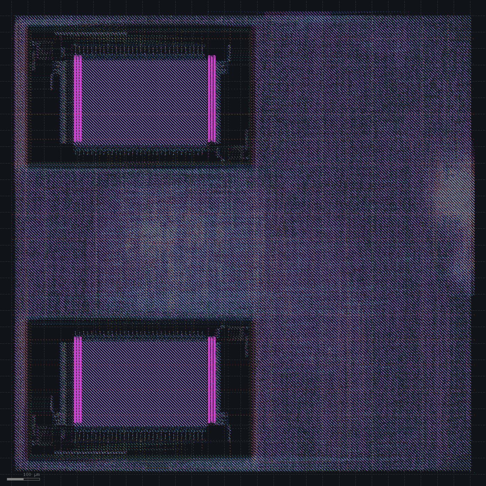
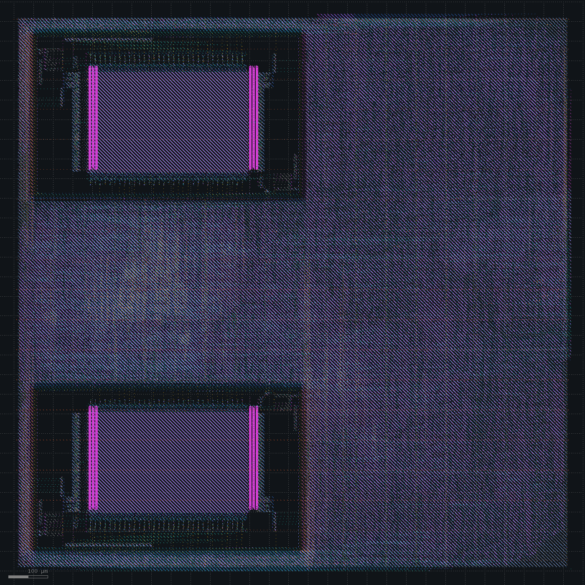
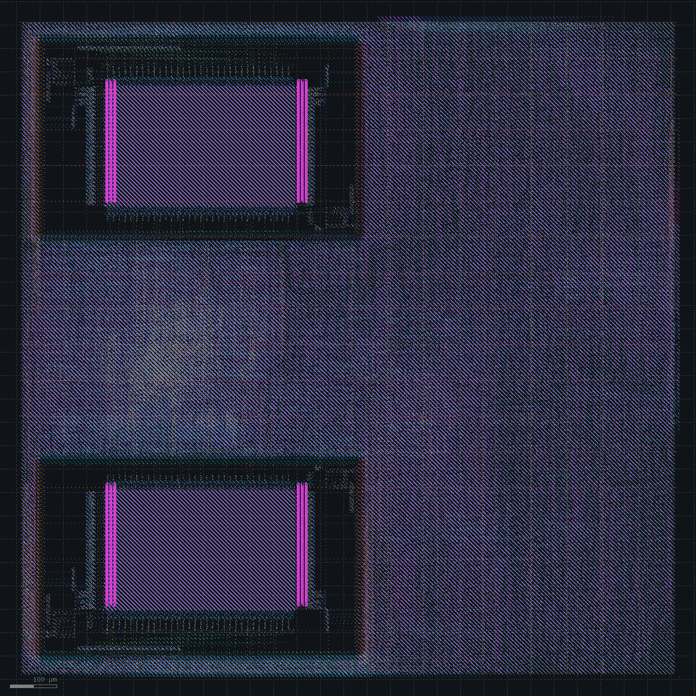

# PCIe adapter

Spec: [spec_v4.md](../spec_v4.md). The SoC gains a PCIe Gen1 x4 root port. The link and transaction layers are on chip, and an external PHY handles the serial side over a 32-bit PIPE interface at 62.5 MHz ([pcie_feasibility.md](../pcie_feasibility.md)). CPU loads and stores in `0x4000_0000` to `0x4FFF_FFFF` become one-DW memory reads and writes. The macro goes from 113 to 424 pins.

The testbench connects the SoC to a second copy of the link layer in endpoint mode, through two PIPE PHY models, with 1 KB of memory behind it. The firmware waits for the link, writes eight words, reads them back and stores a byte. RTL simulation passes with the link in L0 and no replays.

Three mutations check that the test can fail. A flipped LCRC bit hangs the firmware, and rotated receive lanes stop link training. A wrong Ack sequence number passed at first, with 18 replays: the endpoint took each replayed TLP as a duplicate and acknowledged it with the right number. The firmware now also fails on any replay.

| Change | Setup WNS clk / mclk / pclk (ns) | Hold WNS (ns) | Gate-level sim | DRC / LVS |
|---|---|---|---|---|
| PCIe port, `pclk` at 16 ns | +1.43 / +2.39 / +4.54 | +0.078 | hangs | clean |
| Falling-edge PIPE inputs, registered LCRC compare, replay timer reset | +0.88 / +2.28 / +5.55 | +0.067 | hangs | clean |
| Reset on every link counter and flag, input pin buffers | +0.93 / +2.26 / +5.31 | +0.078 | passes | clean |

## Spec v4

Synthesis grows from 23,012 cells (809k µm²) to 27,724 cells (873k µm²), and flops from 3,472 to 5,021. The die is 1413 x 1413 µm at 45% core utilization.

The first detailed routing took 51 passes, about 40 of them at a single violation. It left 306 nets with antenna violations. The diode passes brought them to 34, 12 and 2, and the antenna buffers cleared the last two. The last routing pass stopped at its iteration limit with one met1 short that Magic, KLayout and LVS do not see.

Timing closes at signoff: `clk` +1.43 ns (73.7 MHz), `mclk` +2.39 ns (131 MHz), `pclk` +4.54 ns (87.3 MHz). Hold is +0.078 ns. Power is 45.7 mW and IR drop 5.02 mV. DRC and LVS are clean. No pin exceeds its capacitance limit, `u_sram.mem/dout1[10]` included.

Gate-level simulation hangs after the third PCIe write. The replay timer `replay_t` has no reset, and the transmitter clears it before first use. In the netlist the clear of bit 0 goes through an `o21ba` cell that computes `(Q | inc) & !(Q & (clr | inc))`. With `Q` unknown and the clear active, that is `X & !X`, which simulates as X. The X climbs the counter into `rb_send`, and the transmitter stops.

Hold repair after CTS pads the PIPE inputs. 1,079 of the 1,508 hold buffers sit on chains that start at PIPE receive pins, up to 12 in a row. The repair worked from a 2.27 ns `pclk` tree in the CTS estimate. At signoff the tree is 1.39 to 1.57 ns, and the padded `pipe_rx_datak[13]` has 3.3 ns more hold slack than it needs. The worst `pclk` setup path runs through those 12 buffers.

A candidate with the PIPE inputs registered on the rising edge ran through CTS. The input paths cleared, and hold repair added 2,976 buffers. The worst `pclk` path moved inside the link, to the check of a received TLP: in one cycle it selects a byte by counter, folds it into the CRC, compares the LCRC at a position chosen by the TLP length, checks END and the sequence number, and increments `rx_seq` (-0.40 ns at CTS).

Decision: capture the PIPE inputs on the falling edge of `pclk` and again on the rising edge, compare the LCRC from a register with a two-way length select, and reset the replay timer.

## Falling-edge PIPE inputs

The 161 PIPE receive bits pass through a falling-edge and a rising-edge register, one more `pclk` of receive latency. The CRC loop over a received TLP runs one more cycle, so the LCRC compare reads a register, and a one-bit length flag picks where the LCRC and END sit. Synthesis gives 28,292 cells (881k µm²) and 5,325 flops. The die is 1420 x 1420 µm, and global placement raises the density target from 0.50 to 0.51.

No hold buffers are inserted. The first detailed routing converges in eight passes, and the antenna passes go 230, 20, 2, 1.

Setup closes: `clk` +0.88 ns (70.8 MHz), `mclk` +2.28 ns (130 MHz), `pclk` +5.55 ns (95.7 MHz). The worst `pclk` path is now the half cycle from a PIPE pin to its falling-edge flop. Hold is +0.067 ns. Power is 47.3 mW and IR drop 2.45 mV. DRC and LVS are clean.

One antenna net is left. `pipe_rx_status[3]` runs on met4 straight from its pin to the flop, with a side-area ratio of 1813 against 400, and no cell drives it. It shows up after the finish step buffers another net and reroutes, and nothing repairs it after that.

Gate-level simulation hangs again, at the first PCIe read. The receive byte counter `rp_n` has no reset either. It is loaded with 1 when the check of a TLP starts, and in this netlist bit 0 of the load comes out X the same way, then spreads into the receive state and the transaction FSM. A netlist of the first link-layer RTL with only the replay timer reset passes, with the same `rp_n` code in different gates.

Yosys also reports latches on two loop variables of the transmit block. None reach the netlist.

Decision: a reset on every counter and flag in the link layer, a buffer next to every input pin, and the loop variables cleared.

## Link resets and input pin buffers

Every counter and flag in the link layer now has a reset. Data registers do not. A `buf_1` sits next to each of the 188 input pins. Synthesis gives 28,098 cells and no latches.

Gate-level simulation passes, with the same cycle counts as RTL.

The first detailed routing converges in ten passes, and the antenna passes go 233, 18, 3, 1. Setup closes: `clk` +0.93 ns (71.1 MHz), `mclk` +2.26 ns (129 MHz), `pclk` +5.31 ns (93.6 MHz). Hold is +0.078 ns. Power is 47.5 mW and IR drop 4.08 mV. DRC and LVS are clean.

Three antenna nets are left, all from the finish step. It put a buffer in front of the last violating gate and rerouted. Afterwards one violation sits on the new buffer's own input, and two on nets the reroute changed: `u_sdram.p_we_n` on met3 and an SRAM address buffer input on met2. The step checks antennas after the reroute and repairs nothing.

Decision: run the diode passes again after the finish step reroutes.
