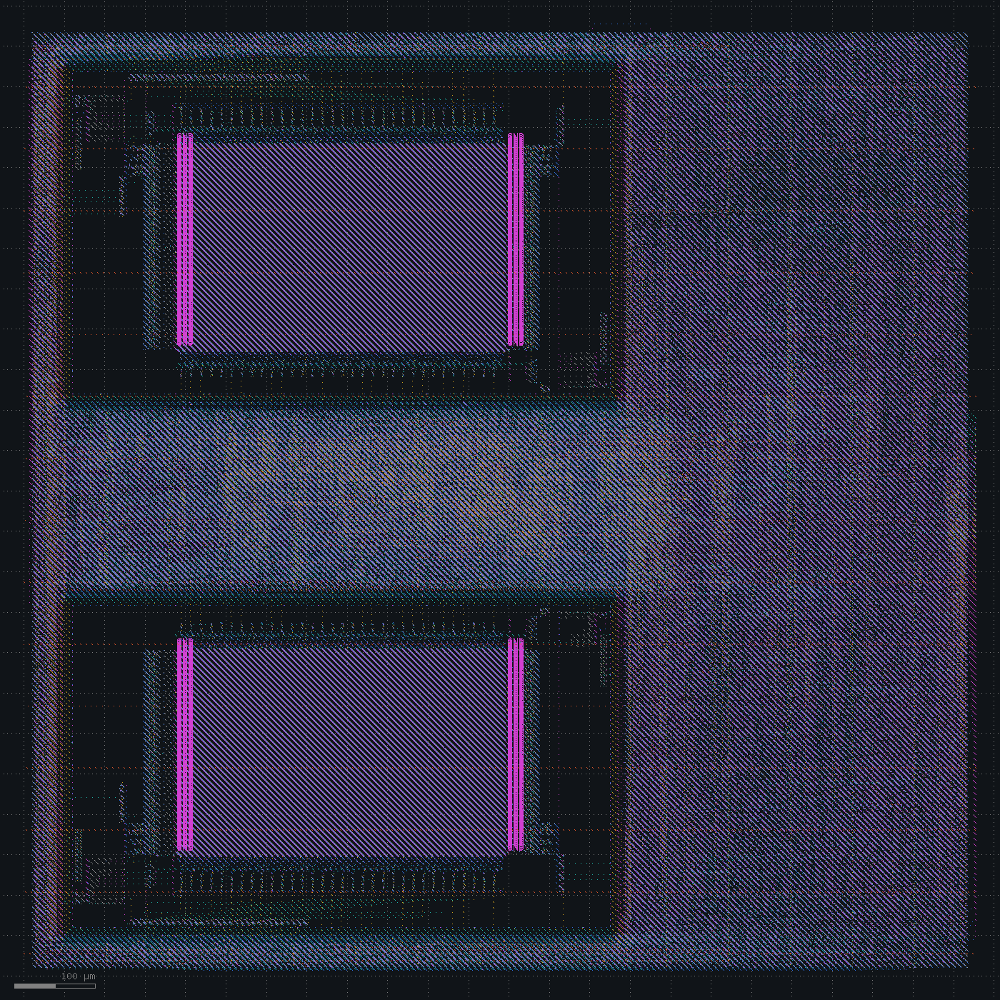
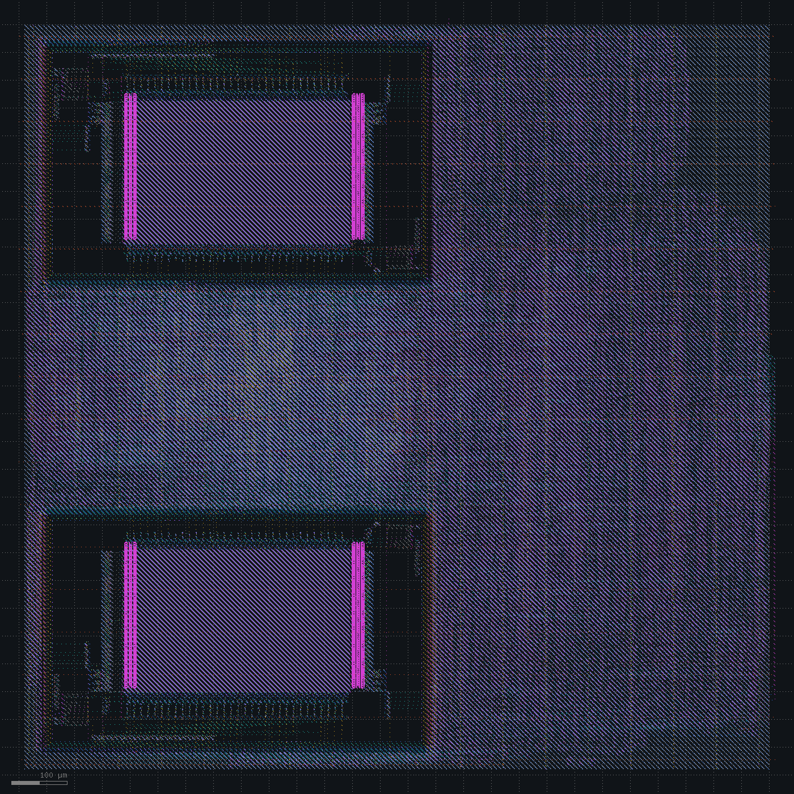

# Performance push

Spec: [spec_v3.md](../spec_v3.md). The CPU gains the M extension, code runs from SDRAM through a 2 KB instruction cache in a second SRAM macro, and the system clock target moves from 50 to 66.7 MHz (15 ns).

The firmware boots in two stages. A 292-byte loader in SRAM copies the program from SPI flash into SDRAM and jumps to it. That program runs 50 RV32IM checks (14 of them for the M extension, including divide by zero and -2^31 / -1), the interrupt, SPI and SDRAM tests, and an 8x8 matrix multiply with divides whose products are checked against shift-and-add. RTL and gate-level simulation pass with 0 SDRAM protocol errors. Marking a cache line valid when its refill starts makes the test hang at `0x80000000`.

The benchmark takes 10,937 cycles cold and 10,347 warm.

| Change | Setup WNS clk / mclk (ns) | Failing endpoints | Hold WNS (ns) | DRC / LVS |
|---|---|---|---|---|
| M extension, instruction cache, 15 ns clock | -3.08 / +1.81 | 928 | +0.076 | clean |
| Two-cycle multiplier | routing stopped | | | |
| No buffering in the timing repair after global routing | routing stopped | | | |
| Core utilization 60% to 52% | routing stopped | | | |
| Core utilization 45%, placement density 0.5 | +2.31 / +2.08 | 0 | +0.080 | clean |
| Buffer at every SRAM output | | | | |

## Spec v3

Synthesis grows from about 410k to 805k µm²: the second SRAM is 285k, and standard cells go from about 121k to 235k µm². The cache SRAM sits in the upper-left corner, mirrored, so that its fetch port faces down toward the core. The die is 1178 x 1178 µm at 64% utilization.

| Check | Result |
|---|---|
| Setup `clk` | -3.08 ns, TNS -1063 ns, 928 failing endpoints, 55.3 MHz |
| Setup `mclk` | +1.81 ns |
| Hold | +0.076 ns |
| Power | 31.7 mW |
| IR drop | 2.89 mV |
| Antenna | 0 |
| DRC / LVS | clean |

The ten worst paths start at instruction register bits and end in the register file. A case analysis that holds instruction bit 25 (the M opcode bit) at 0 takes the multiplier and divider out of the timing graph:

| | WNS (ns) | Failing endpoints |
|---|---|---|
| With M | -3.08 | 928 |
| Without M | -1.78 | 757 |

The multiplier costs 1.3 ns. The rest of the core also misses 15 ns.

Decision: split the multiplier over two cycles.

## Two-cycle multiplier

The first cycle registers four 17x17 partial products of the 33-bit operands (134 flops). The second adds them and writes the result. A multiply now takes one extra cycle: the warm benchmark goes from 10,347 to 10,859 cycles, 512 more for its 512 multiplies.

Review of the stall logic found a bug in the M extension: the divider started while EX was waiting for a load, so `lw t3, ...; div t1, t3, t2` divided the old `t3`. Check 51 does exactly that and fails on that RTL. The divider and the multiplier now wait until no load is pending on their operands. RTL and gate-level simulation pass all 52 checks.

The post-CTS estimate improves from -11.08 to -0.89 ns. After global routing, `repair_timing` sees -4.5 ns, inserts 1532 buffers and upsizes 2526 cells; with the single-cycle multiplier the same step upsized 1539 cells and inserted no buffers. Detailed routing started at 74,062 violations (before: 46,339) and still had 38,134 after six passes and 44 minutes, and was stopped.

The estimate after global routing has been pessimistic every time since it was introduced. These pairs are on nearly the same netlist, before and after detailed routing:

| WNS after global routing (ns) | Signoff WNS (ns) |
|---|---|
| -0.59 | +5.69 |
| -0.60 | +3.39 |
| -0.24 | +2.14 |
| -0.46 | +1.96 |
| -9.16 | -3.08 |

Decision: keep `repair_design` after global routing, and run `repair_timing` there without buffer insertion.

## Resize-only timing repair after global routing

After global routing, `repair_timing` now upsizes 986 cells and clones 118, with no buffers. Detailed routing starts at 59,240 violations and stalls: 44,433, 41,608, 22,011, 18,630, 17,852, 17,538, 17,414. Routing was stopped after eight passes.

Global routing reports no overflow, so the problem is local. Standard-cell density after CTS, in 50 µm bins:

| Bins at or above 50% | Densest bin |
|---|---|
| 7 | 56% |
| 27 | 64% |

The densest bins sit in the band between the two SRAMs and in the upper right. Global placement targets 60%, then `repair_design` and the CTS repair add about 1500 buffers into the regions that are already full.

Two candidates ran in parallel copies of the flow: placement density 0.5, and routability-driven plus timing-driven global placement.

Both candidates exposed something else. Global placement had been ignoring the 0.6 target since the 60% die:

| Placement density used |
|---|
| 0.60 |
| 0.73 to 0.74 |

Since the 60% die, the log warns that "target density 0.6000 is too low for the available free area" and places at 0.74. That die left too little free area once padding is counted. It still routed before the M extension; with twice the standard-cell area, the design needed 27 detailed routing passes. The 0.5 candidate was raised to 0.74 the same way, and the routability-driven candidate failed: timing-driven placement repairs design rules before the SRAM input buffers exist and hits RSZ-0090. The metrics table now has the density placement actually used.

Placement keeps 0.60 at 52% core utilization (die 1267 x 1267 µm) and is raised to 0.63 at 55%.

Decision: 52%.

## 52% core utilization

Placement uses 0.60. The post-CTS estimate is -0.69 ns. Detailed routing starts at 49,166 violations and stalls again: 36,742, 33,685, 15,658, 12,420, 11,864, 11,737, 11,341, 11,150, 10,661. Routing was stopped after ten passes.

A copy of the same database, routed for six passes with the DRC report written out, puts every one of its 11,657 violations within about 300 x 300 µm around (450, 550) µm, between the two SRAMs. 10,000 are shorts, 6931 of them on met1. That region holds register file flops, about 200 `buf_12` cells from `repair_design`, and about 430 of the 681 buffers that `repair_timing` inserts after CTS. In 25 µm bins, cell area reaches 71% there, before padding.

Placement at density 0.5 needs a lower core utilization. Through CTS:

| Core utilization | Die (µm) | Density used | 25 µm bins at or above 60% | Densest |
|---|---|---|---|---|
| 52% | 1267 | 0.60 | 16 | 71% |
| 45% | 1361 | 0.50 | 7 | 63% |
| 42% | 1408 | 0.50 | 5 | 72% |

Decision: 45% core utilization, placement density 0.5.

## 45% core utilization, density 0.5

The die is 1361 x 1361 µm and placement uses 0.50. Detailed routing converges in seven passes (37,281, 23,970, 22,405, 2,495, 333, 80, 0), and the antenna loop clears every net.

Setup closes at 15 ns: `clk` +2.31 ns (78.8 MHz), `mclk` +2.08 ns (126 MHz). Hold is +0.080 ns. DRC and LVS are clean. Power is 33.9 mW and IR drop 3.09 mV. The estimate after global routing said -4.0 ns.

One capacitance violation is left: SRAM output `dout1[10]` drives 0.08 pF against the macro's 0.0276 pF limit, the edge of its characterized load range.

Decision: a buffer at every SRAM output pin as well, with only the pin-to-buffer net kept out of repair.

## SRAM output buffers

