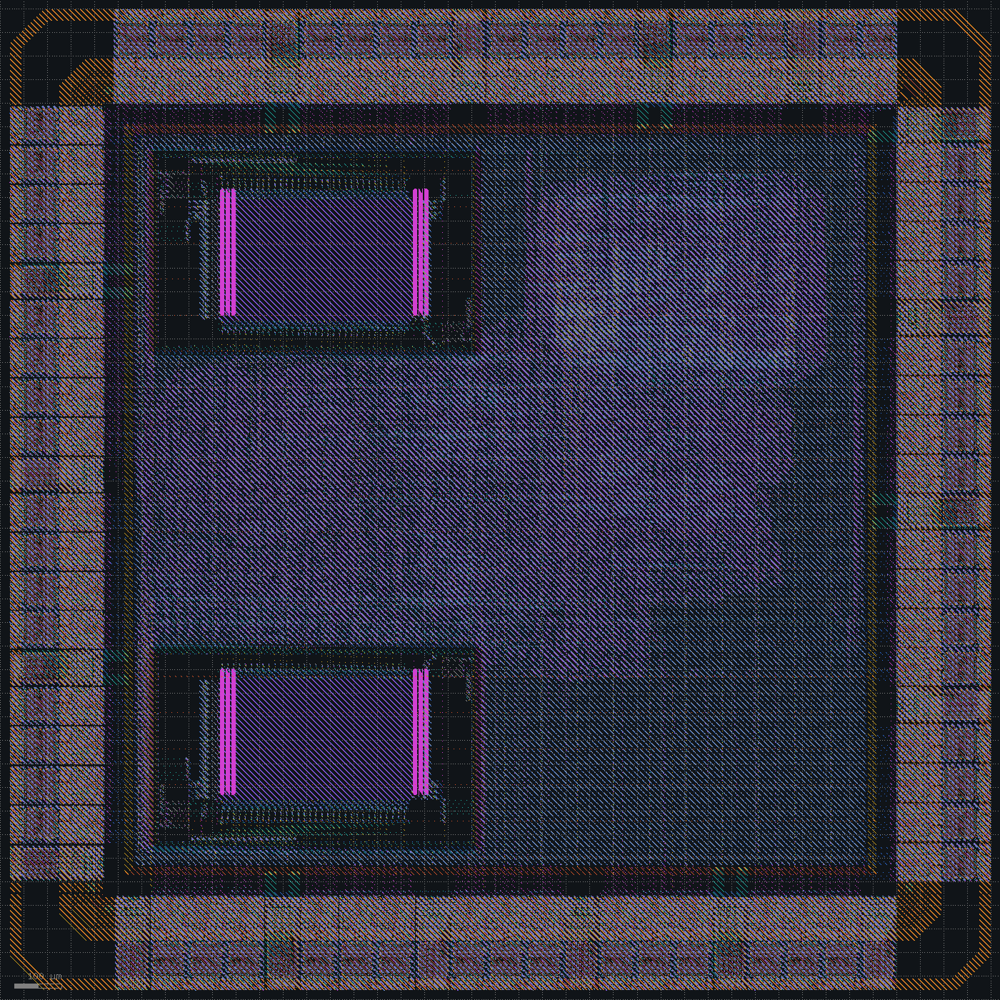
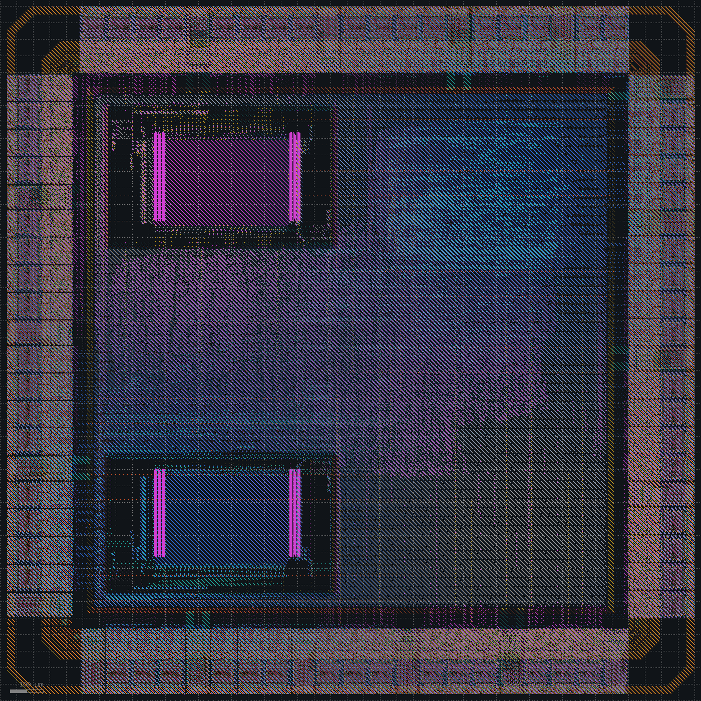

# Signoff

Spec: [spec_v8.md](../spec_v8.md). Signoff covers three corners instead of one. Setup is checked at the slow corner (ss_100C_1v60 with maximum interconnect RC) and hold at the fast corner (ff_n40C_1v95 with minimum RC), on top of the typical corner. The pads have liberty files for both corners. The SRAM has only a TT liberty, so the slow and fast corners use copies scaled by the clock-to-Q ratio of a standard-cell flop: delays and setup constraints x2.1 at the slow corner, delays x0.64 at the fast one. Each corner runs in its own STA session, because in one multi-corner session the clocks forwarded through the pads keep one latency for all corners. IR drop is now sourced where the straps from the supply pads meet the ring.

| Change | Setup WNS clk / mclk, tt (ns) | Setup WNS clk / mclk, ss (ns) | Hold WNS tt / ff (ns) | DRC / LVS |
|---|---|---|---|---|
| Three corners on the pad-ring layout | +0.86 / +0.50 | -8.32 / -2.87 | +0.022 / -0.086 | clean |
| Slow corner at 50 / 62.5 MHz, 0.2 ns hold margin, design repair after timing repair, metal fill | +0.96 / +0.42 | +1.98 / +1.47 | +0.189 / +0.019 | clean |
| 10% slew and load margin in design repair | +0.98 / +0.43 | +1.95 / +1.49 | +0.176 / +0.013 | clean |
| 50% slew margin | +0.77 / +0.65 | +1.91 / +1.86 | +0.167 / +0.007 | clean |

## Three corners

Extraction, STA and IR analysis run again on the pad-ring layout; synthesis, place and route, DRC and LVS are unchanged.

The typical corner matches the pad-ring signoff. The slow corner fails setup on 2,830 endpoints:

| Path | Slack at ss (ns) |
|---|---|
| Inside the core, `clk` | -8.32 (54.6 MHz) |
| Inside the SDRAM controller, `mclk` | -2.87 (77.7 MHz) |
| SDRAM write data to `sdram_dq[15]` | -1.39 |
| SPI MOSI and CS | +6.61 |

Hold at the fast corner fails on 22 endpoints, by up to 0.086 ns, all between flops inside the core; the SDRAM and SPI pins keep more than 4 ns. At the slow corner the net that breaks its limits at tt reaches 4.28 ns of slew against 1.49 ns, and two more nets go over.

IR drop from the pads is 17.3 mV on VPWR and 16.3 mV on VGND, against 2 mV when every met5 node was a source.

Decision: specify the slow corner at 50 MHz on both clocks and size the SDRAM refresh interval for 50 MHz, repair hold at the typical corner with 0.2 ns of margin, repair slew and load once more after timing repair, and fill the metal layers.

## Slow-corner clocks, hold margin, fill

The slow corner is now specified at `clk` 50 MHz and `mclk` 62.5 MHz. Checked on the same layout, 50 MHz on `mclk` breaks hold on SDRAM read data by 0.26 ns: the read is captured a fixed cycle and a half after the SDRAM clock edge, and with a 20 ns cycle the next read's data reaches the flop before that edge. At 62.5 MHz it closes. The clock-domain crossings at the slow corner are bounded by 16 ns. The SDRAM refresh interval drops from 750 to 480 cycles, 7.7 µs at 62.5 MHz and 4.8 µs at 100 MHz; the benchmark takes 13,233 cycles cold.

Hold repair at the typical corner keeps 0.2 ns of margin, which adds 61 hold buffers at CTS and 21 after global routing. Slew and load repair runs once more after timing repair. The GDS step fills met1 to met5 on the sky130 fill layers: squares of 2 µm on a 4 µm pitch on met1 to met3 and 3 µm on 6 µm on met4 and met5, at least 1 or 2 µm from drawn metal, outside the seal ring, the I/O cells and the SRAMs. The PDK's density check then runs on the filled GDS.

Synthesis gives 22,860 cells.

All three corners close:

| Corner | Setup, worst (ns) | Hold, worst (ns) |
|---|---|---|
| tt, 100 MHz | +0.42, `sdram_dq[15]` write data; +0.96 inside the core | +0.189 |
| ss, `clk` 50 MHz, `mclk` 62.5 MHz | +1.47, `sdram_dq[15]` write data; +1.98 inside the core (55.5 MHz max) | +0.648 |
| ff, 100 MHz | +1.36 | +0.019 |

No pin is over its slew or load limit at tt or ff apart from the waived SRAM inputs. At ss one net is 0.04 ns over its 1.47 ns slew limit.

Power without the pad cells is 50.4 mW and IR drop 17.1 mV. Antennas and router DRC are at 0, Magic and KLayout find nothing outside the I/O cells, LVS matches, and the density check passes: the metal layers are 26 to 38% covered after fill.

Gate-level simulation passes with flops starting at 0 and at 1.

Decision: keep 10% of slew and load margin in design repair, and simulate the routed netlist with the signoff delays.

## 10% slew and load margin

Design repair keeps 10% of margin on slew and load. Timing ends where it was: tt +0.98 / +0.43 ns, ss +1.95 / +1.49 ns (55.4 MHz on `clk`), hold +0.176 ns at tt and +0.013 ns at ff. LVS matches, DRC and the density check are clean, and power and IR drop stay at 50.4 mW and 17.1 mV.

The margin does not reach the slow corner. Two nets are still over the 1.49 ns slew limit there, at 1.60 and 1.49 ns. At tt the same nets are at 0.86 and 0.77 ns, and the slow corner nearly doubles a slew. Only three cell outputs at tt are above 0.75 ns.

Decision: keep 50% slew margin in design repair.

## 50% slew margin

Design repair keeps 50% of margin on slew and 10% on load. Synthesis gives the same netlist as before.

| Corner | Setup, worst (ns) | Hold, worst (ns) |
|---|---|---|
| tt, 100 MHz | +0.65, `sdram_dq[15]` write data; +0.77 from the SRAM read port (108.4 MHz max) | +0.167 |
| ss, `clk` 50 MHz, `mclk` 62.5 MHz | +1.86, `sdram_dq[15]` write data; +1.91 from the SRAM read port (55.3 MHz max) | +0.622 |
| ff, 100 MHz | +1.52 | +0.007 |

No pin is over its slew limit at any corner apart from the waived SRAM inputs. One SRAM output, `dout1[16]` of the data SRAM, drives 0.063 pF, and its liberty ends at 0.0276 pF: the net to a buffer 12 µm away is routed 450 µm around the SRAM pin row. Paths through the pin keep 3.79 ns of setup slack at tt and 7.65 ns at ss, and the pin is waived.

Power without the pad cells is 50.4 mW, and IR drop is 17.1 mV on VPWR and 16.6 mV on VGND. Antennas and router DRC are at 0, Magic and KLayout find nothing outside the I/O cells, LVS matches, and the density check passes.

The routed netlist runs the test with the signoff delays (`make gls_sdf`). The first attempts failed on the simulation setup, not on the chip:

- The SRAM model drives read data 3 ns after the falling clock edge, a placeholder OpenRAM value, and X from 1 ns after the rising edge until then. The liberty gives 0.38 to 0.53 ns. 1,022 endpoints behind the data SRAM's read-write port have less than 2.6 ns of setup slack at tt and caught the X; the stack pointer went X on the first instruction. The model now drives data 0.53 ns after the falling edge.
- The pads had no delay: iverilog takes the typical value of the pad model's delays, which is 0. `sdram_clk` reached the SDRAM about 4 ns early, the falling-edge capture took each read word one slot late, and the second word read the released bus. The pads now take their OUT, OE_N and IN delays from the SDF.
- The testbench read the result from the GPIO pins while they were still switching. It now waits 100 ns.

The test then passes in 11.92 ms: 13,218 cycles cold and 12,484 warm. The cold count is 15 cycles under the zero-delay simulation, because clock latency moves edges at the clock-domain synchronizers.

eqy splits the RTL and the synthesized netlist into 1,016 partitions. It proved 147 of them, and about 100 others, among them the SPI clock, the SRAM read data and the SDRAM controller's two-clock logic, ended unknown or failed from the initial state. It was stopped there.

## Status

The chip passes signoff at three corners: setup at the slow corner, hold at the fast corner, slew and load, DRC outside the SkyWater I/O cells, LVS, antennas, density, and gate-level simulation with routed delays.

| | Before | After |
|---|---|---|
| Corners | tt | tt, ss, ff |
| `clk` | 100 MHz at tt, 109.4 MHz max | 100 MHz at tt, 108.4 MHz max; 50 MHz at ss, 55.3 MHz max |
| `mclk` | 100 MHz at tt, 105.3 MHz max | 100 MHz at tt, 107.0 MHz max; 62.5 MHz at ss, 70.7 MHz max |
| Hold, worst (ns) | +0.022 at tt | +0.167 at tt, +0.007 at ff |
| Slew and load | one net over | SRAM pins only, waived |
| IR drop | 2 mV, every met5 node a source | 17.1 mV, sourced at the supply pads |
| Metal fill | none | met1 to met5, density check clean |
| Gate-level simulation | zero delay | zero delay, and typical-corner delays from the SDF |
| SDRAM refresh interval (cycles) | 750 | 480 |

Open:

- RTL and netlist are not proven equivalent; they agree in simulation.
- The SRAM slow and fast corners are scaled from its typical liberty.
- Power leaves out the pad cells.
- Extraction does not see the metal fill.
- In the SDF simulation the SRAMs use one read delay from their liberty, not annotated values.
