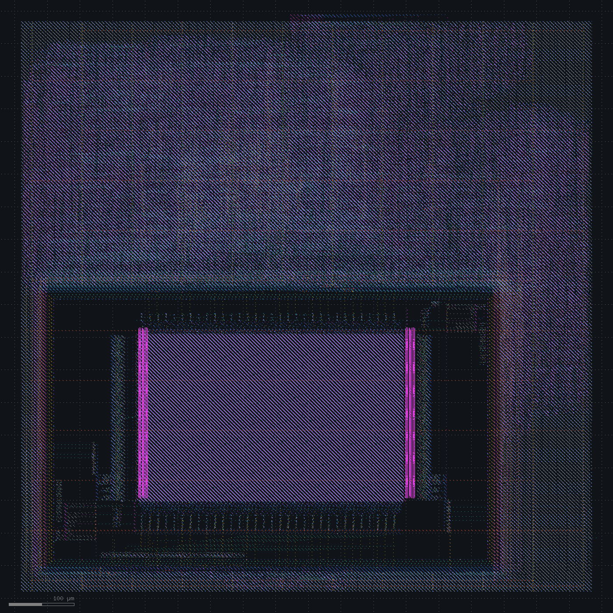

# Timing closure

Goal: close 50 MHz at tt_025C_1v80 on the design as it stands.

## Where the slack goes

Worst setup slack with placement padding, by path group:

| Path group | Worst slack (ns) |
|---|---|
| Through SRAM `dout1` (instruction fetch) | -3.68 |
| Into SRAM `addr1` (next fetch address) | -3.46 |
| Through SRAM `dout0` (load data forwarded into EX) | -2.95 |
| Failing endpoints that do not start at the SRAM | 0 of 1209 |

The SRAM launches both read ports on the falling clock edge. Every failing path gets half a cycle.

Decision: fix it in the RTL.

| Change | WNS (ns) | TNS (ns) | Failing endpoints | Slew / cap violations | DRC / LVS |
|---|---|---|---|---|---|
| Instruction register | -4.74 | -4708 | 1275 | 2410 / 147 | clean |
| Load-use stall instead of load forwarding | -0.23 | -2.9 | 19 | 2785 / 203 | clean |
| Wire capacitance calibrated to OpenRCX | +2.78 | 0 | 0 | 229 / 37 | clean |
| Buffer at every SRAM input | +4.24 | 0 | 0 | 172 / 22 | clean |
| Repair after global routing | +5.69 | 0 | 0 | 22 / 0 | clean |

## Instruction register

The fetched word goes into an instruction register at the rising edge, and decode starts from there. A taken branch or jump now costs one cycle.

`repair_design` stopped with RSZ-0090. The SRAM liberty gives its address and data inputs a 40 ps `max_transition`, the top of the macro's characterization range, and the best a sky130_fd_sc_hd driver reaches on those nets is 46 ps. The nets into the SRAM inputs are now dont_touch during `repair_design`. STA still reports the limit.

| Path group | Before | Instruction register |
|---|---|---|
| Through `dout1` | -3.68 | +9.11 |
| Into `addr1` | -3.46 | -3.77 |
| Through `dout0` | -2.95 | -4.74 |

The fetch path is fixed. Every failing path now starts at `dout0`: load data forwarded into the ALU, the branch target and the next fetch address.

Decision: drop load forwarding. An instruction that reads a register still being loaded waits one cycle.

## Load-use stall

SRAM load data now only feeds the load alignment and the register file write. Those are the only paths left that start on the falling edge.

WNS is -0.23 ns, TNS -2.9 ns, 19 failing endpoints, 49.4 MHz. DRC and LVS are clean.

The worst path runs from an instruction register flop through the register file read, the ALU and the register file write. Most of its delay sits in small cells on long nets. One `or2_0` drives 0.21 pF and takes 2.34 ns.

The estimates before routing do not match signoff. On the routed database, placement-based parasitics give WNS +5.55 ns and OpenRCX gives -0.23 ns. Over 769 sampled nets, extracted wire capacitance is 2.40 times the estimate. Net `_04613_` has 13 loads over 300 µm: 0.070 pF estimated, 0.180 pF extracted. Setup repair after CTS sizes cells for the smaller number.

The estimate uses met2 from the tech LEF: 8.93e-4 kΩ/µm and 77.9e-6 pF/µm.

Decision: estimate signal wires at 8.93e-4 kΩ/µm and 1.87e-4 pF/µm (2.40 x 77.9e-6).

## Calibrated wire capacitance

`repair_design` after placement now finds 337 slew and 90 capacitance violations (before: 224 and 41) and inserts 412 buffers (before: 166).

Setup closes: WNS +2.78 ns, TNS 0, 58.1 MHz. Hold is +0.084 ns. DRC and LVS are clean. The post-CTS estimate of +3.23 ns is within 0.45 ns of signoff.

The design-rule report disagrees. Signoff has 229 max-slew and 37 max-capacitance violations, and every earlier layout had more: 1856 slew violations with placement padding and 2785 with the load-use stall. The metrics table did not count them until now.

- 22 are SRAM input pins against the 40 ps limit. The nets into port 0 cross to the bottom edge of the macro with no buffer, because of the dont_touch on those nets, and reach 7 to 9 ns.
- The rest sit on nets that gained load after routing. Net `_10282_` picked up 11 antenna diodes and reaches 8.28 ns. The flow repairs slew and capacitance only at placement.

Decisions: buffer each SRAM input next to its pin and keep only that short net out of `repair_design`; repair design rules and setup again after global routing.

## SRAM input buffers

After global placement, a `buf_4` goes next to each of the 57 SRAM data, address and control inputs. Only the 57 short buffer-to-pin nets are dont_touch. `insert_buffer` crashed (signal 11 in `dbBlock::makeNewName`) until the buffers got explicit names.

SRAM input slews drop from 7 to 9 ns to 0.09 to 0.11 ns. 23 pins still exceed the 40 ps limit.

WNS is +4.24 ns, 63.4 MHz. Of the 172 slew violations, 23 are SRAM pins and 82 are antenna diode pins. The worst of the rest is 2.16 ns against a 1.5 ns limit, on the net into `sram_buf_addr0_033`.

## Repair after global routing

Global-route parasitics now use the LEF layer RC with capacitance scaled by 1.91. That factor is the ratio of OpenRCX to global-route wire capacitance over 769 nets of the calibrated layout. Placement estimates keep the 2.40 factor on met2.

After global routing, `repair_design` finds 617 slew and 235 capacitance violations, inserts 536 buffers and resizes 506 cells. `repair_timing` resizes 29 more. The changed nets are rerouted incrementally.

WNS is +5.69 ns, TNS 0, 69.9 MHz. Hold is +0.079 ns. There are no capacitance violations. The 22 slew violations left are all SRAM pins, 0.05 to 0.06 ns against the 40 ps limit. DRC and LVS are clean, with 64 antenna nets. Power rises from 9.98 to 11.50 mW.

The worst path starts at SRAM `dout0` on the falling edge and ends in the register file.

## Status

50 MHz closes at tt_025C_1v80 with 5.69 ns of setup slack and no hold violations. DRC and LVS are clean. Open items: 64 antenna nets, and 22 SRAM input pins over the 40 ps characterization limit.

