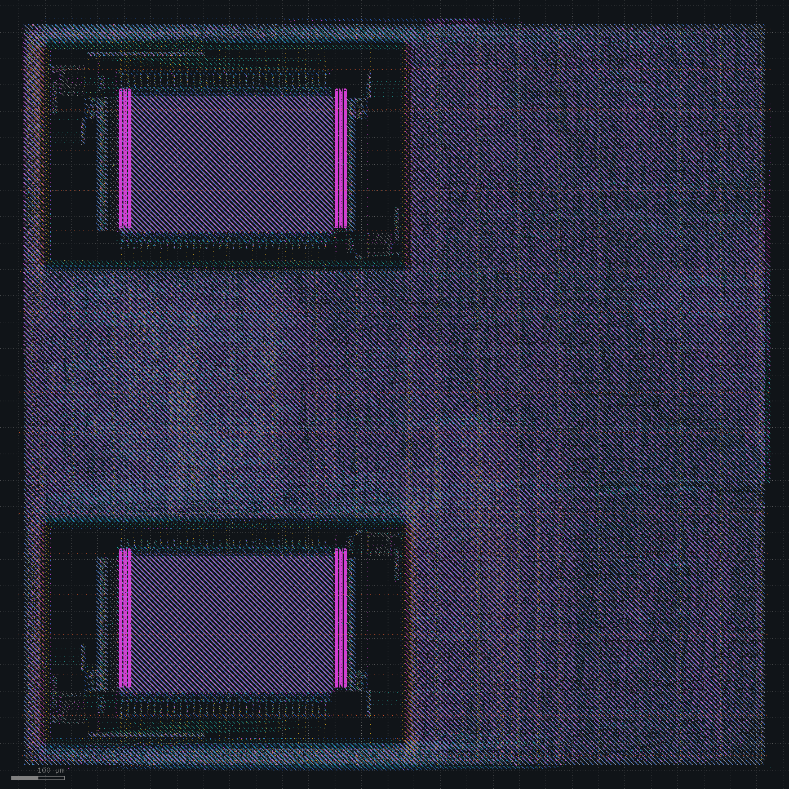
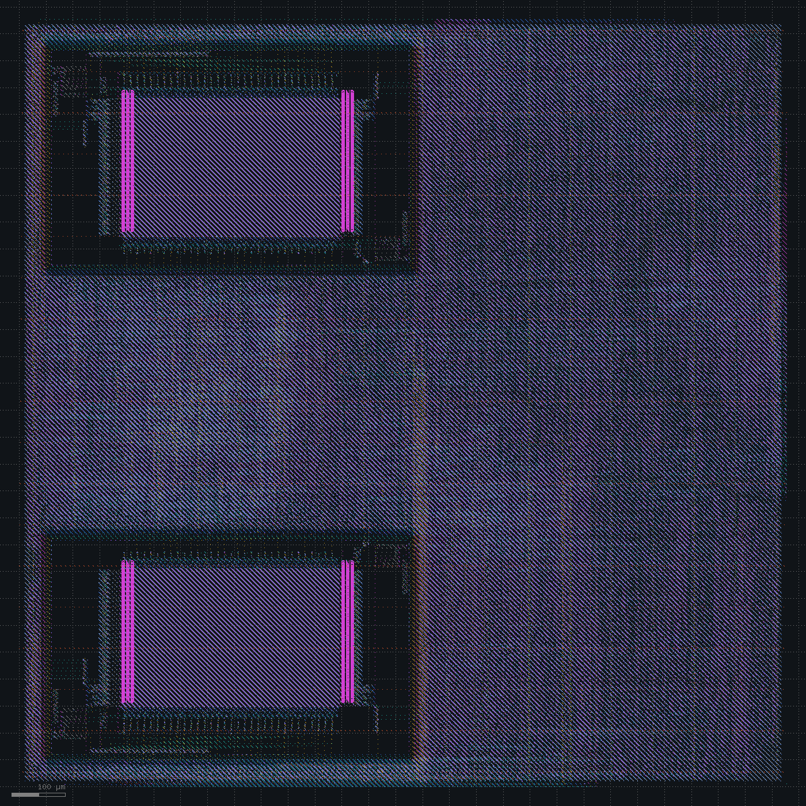
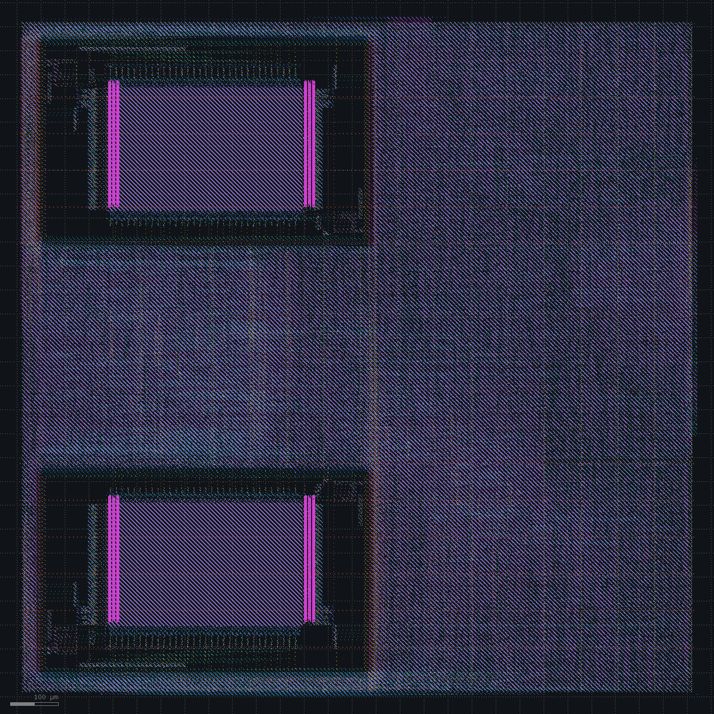

# Timing optimization

Spec: [spec_v5.md](../spec_v5.md). The system clock target moves from 66.7 to 100 MHz (10 ns). The UART divisor becomes 868, and the delay limit on crossings between `clk` and `pclk` becomes 10 ns. RTL simulation passes. The benchmark takes 11,555 cycles cold and 10,859 warm; cold grows because a cache refill from SDRAM now costs more `clk` cycles.

| Change | Setup WNS clk / mclk / pclk (ns) | Failing endpoints | Hold WNS (ns) | DRC / LVS |
|---|---|---|---|---|
| `clk` at 10 ns | -4.11 / +2.28 / +5.30 | 1904 | +0.075 | clean |
| Register-read stage, bus request from WB registers, three-cycle multiply | -0.39 / +2.18 / +5.47 | 10 | +0.079 | clean |
| Kogge-Stone carry | -0.40 / +2.21 / +5.43 | 5 | +0.077 | clean |
| Booth-encoded multipliers | -1.02 / +2.19 / +5.41 | 34 | +0.077 | clean |

## 10 ns

Synthesis gives the same netlist as before, gate for gate: the ABC delay target follows the clock, and 10 ns maps the same as 15 ns.

`clk` misses by 4.11 ns (70.9 MHz) on 1904 endpoints. `mclk`, `pclk` and hold close, DRC and LVS are clean, and power is 63.3 mW. Every failing path starts at the EX instruction register: decode, register file read, then the ALU or an adder. They end in the register file (992), in the PCIe and SDRAM command FIFOs through the interconnect (508), at the fetch address, in the CSRs and in the multiplier's partial products.

The worst paths also carry delay chains. Timing repair after CTS builds chains of `buf_1` cells with one load each, up to 39 in a row. The longest before the PCIe port was 4; with it there were already 45, hidden by the 15 ns clock.

A candidate with a register-read stage and the bus request driven from registers ran through CTS at -3.68 ns, against -7.17 ns without it. Its worst path ran from the multiplier's partial products through their 66-bit sum, the new forwarding mux and into an operand register.

Decision: a register-read stage between ID and EX with forwarding from EX, the bus request driven from WB registers, and the multiply sum registered before writeback.

## Register-read stage

RR sits between ID and EX. It reads the register file and registers both operands, taking the EX result instead when EX writes the register being read. An instruction that reads a register still being loaded waits in RR until the cycle after the response. WB drives the bus from registers, so EX only waits for WB to be free. A multiply takes a cycle for the partial products, one for their sum and one to write back. A taken branch or jump now costs two cycles.

The benchmark takes 13,192 cycles cold and 12,484 warm, 15% more than without the stage. Five mutations each hang the firmware: no forwarding to either operand, no wait for a load in EX or in WB, and no flush of RR on a taken branch. Gate-level simulation passes.

Synthesis gives 28,610 cells (889k µm²) and 5,587 flops.

`clk` misses by 0.39 ns (96.2 MHz) on 10 endpoints, TNS -2.1 ns. `mclk`, `pclk` and hold close. DRC and LVS are clean. The die is 1426 x 1426 µm and power 66.7 mW.

The failing endpoints:

| Path | Worst slack (ns) | Endpoints |
|---|---|---|
| EX instruction register to the fetch address, through the branch target adder | -0.39 | 5 |
| Partial products to the multiply sum | -0.38 | 2 |
| Operand to the partial products | -0.21 | 3 |

The worst path is 46 cells. After decode and the immediate select, the target adder `pc + imm` is a chain of about 30 cells, 7.6 ns. Yosys builds the carry as a Brent-Kung tree, and ABC maps it into that chain. Delay chains are shorter here: the longest is 21, and the failing paths carry at most 10.

Decision: Kogge-Stone carry for adders and comparators in synthesis.

## Kogge-Stone carry

Synthesis maps the carry of every adder and comparator as a Kogge-Stone tree. The design grows by 2k µm² to 891k µm² and 28,797 cells. Gate-level simulation passes.

The fetch address and the multiply sum now close. `clk` still misses by 0.40 ns (96.2 MHz), on 5 endpoints, TNS -0.82 ns, all of them partial-product registers. From the operand register, the 17x17 multiply takes about 10 ns, 48 cells including 6 rebuffers. `mclk`, `pclk` and hold close. DRC and LVS are clean. Power rises from 66.7 to 88.3 mW; the vectorless estimate puts the increase in combinational logic, 4.1 to 25.9 mW. `u_sram.mem/dout1[10]` is over its load limit again, 0.07 against 0.03 pF.

A candidate with Booth-encoded multipliers ran through CTS. No partial-product register was among its 400 worst endpoints; 21 were with Kogge-Stone carry alone.

Decision: Booth-encoded multipliers.

## Booth multipliers

Synthesis builds the multipliers with Booth encoding: 27,766 cells and 882k µm², 9k µm² less than before.

`clk` gets worse: -1.02 ns (90.7 MHz) on 34 endpoints. `mclk`, `pclk` and hold close, DRC and LVS are clean, and one antenna net is left. Power drops to 66.8 mW.

| Path | Worst slack (ns) | Rebuffers on the worst path |
|---|---|---|
| Operand to a partial-product register | -1.02 | 47, 5.9 ns |
| Instruction cache hit to the fetch address | -0.94 | 4, 0.65 ns |
| SRAM load data to the register file | -0.11 | 0 |

The multiplier logic on the worst path takes 5.7 ns, then 37 rebuffers in a row, all within 15 µm of each other, add 4.3 ns. The Kogge-Stone layout's failing paths carried 1.1 to 1.2 ns of rebuffers as well. Setup repair after CTS works from the placement estimate, which starts at -11.74 ns here; signoff ends at -1.02 ns. The repair after global routing has skipped buffer insertion for the same kind of gap since it went resize-only.

Gate-level simulation hangs at the first PCIe read. The receive CRC `rp_crc` has no reset and is loaded with all ones when the check of a TLP starts. In this netlist the load leaves it X, and the X reaches the transaction FSM through the LCRC compare. The Kogge-Stone netlist, from the same RTL, passes.

Decision: setup repair after CTS without buffer insertion.
